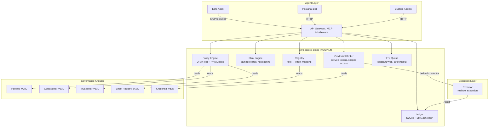

# ezra-control-plane — AGCP v2.0.8 L4 Conformant Specification

**Status**: Production-ready specification
**AGCP Version**: v2.0.8
**Target Conformance**: L4 — Execution Authorization Control
**Baseline Date**: 2026-08-14

---

## 1. Overview

The ezra-control-plane is a **deterministic runtime governance gate** that intercepts every tool call from AI agents and enforces governance policy before execution. It implements the **Agent Governance Control Plane (AGCP)** specification at **Level L4 (Execution Authorization Control)**.

### Key Properties

| Property | Value |
|----------|-------|
| **Type** | Control Plane (not an agent) |
| **Protocol** | MCP middleware + HTTP API |
| **Policy Engine** | OPA/Rego (deterministic) |
| **Ledger** | SQLite append-only + SHA-256 hash chain (DS-040) |
| **Credentials** | Sidecar pattern — agent never sees raw credentials |
| **Human-in-the-Loop** | Telegram/Web queue with 60s timeout, quorum support |
| **Conformance** | AGCP v2.0.8 L4 |

---

## 2. AGCP Conformance Mapping

| AGCP Component | ezra-control-plane Implementation |
|----------------|-----------------------------------|
| **Governance Decision Function (GDF)** | RGG Gate (core evaluation logic) |
| **Policy Evaluation Module (PEM)** | OPA/Rego engine (IF-002 compliant) |
| **Policy Evaluation Contract (IF-002)** | `policy-evaluation-contract.md` |
| **HTTP Interface (IF-001)** | 10 endpoints at `/agcp/v2/*` |
| **Append-Only Ledger (DS-040)** | SQLite + SHA-256 chain |
| **Governance Approval (DS-026)** | Telegram HITL with detached signatures |
| **Proposal Submission (DS-045)** | MCP `tools/call` interception |
| **Commit Boundary** | `commit-boundary-spec.md` |
| **Provenance Wire Format** | ES256 detached signatures |
| **Canonical State** | Derived from ledger + qualified sources |

---

## 3. Architecture



---

## 4. Component Specifications

### 4.1 Registry (Effect Mapping)

```yaml
# effects.yaml
effects:
  - tool: "database.delete_order"
    effect:
      id: "eff-db-delete-order"
      kind: "delete"
      resources: ["db.production.orders"]
      irreversible: true
      max_damage: "all_orders"
      cost_model: "per_row"
      risk_score: "critical"
  
  - tool: "database.read_user"
    effect:
      id: "eff-db-read-user"
      kind: "read"
      resources: ["db.production.users"]
      irreversible: false
      max_damage: "none"
      cost_model: "per_row"
      risk_score: "low"
  
  - tool: "payment.transfer"
    effect:
      id: "eff-payment-transfer"
      kind: "transfer"
      resources: ["payment.gateway.*"]
      irreversible: true
      max_damage: "full_balance"
      cost_model: "per_transaction"
      risk_score: "critical"
```

### 4.2 Blink Engine (Risk Scoring)

```python
# blink_engine.py
class BlinkEngine:
    def score(self, effect: Effect, context: Context) -> RiskScore:
        # Base score from effect
        base = effect.risk_score  # low|medium|high|critical
        
        # Context modifiers
        if context.irreversible and context.production:
            base = escalate(base)
        
        if context.rate_exceeded:
            base = "critical"  # Anti-drip
        
        return RiskScore(
            level=base,
            blink_radius=effect.max_damage,
            requires_hitl=base in ["high", "critical"],
            quorum_required=2 if base == "critical" else 0
        )
```

### 4.3 Policy Engine (OPA/Rego)

```rego
# policy.rego
package agcp.policy

default decision = "deny"

decision = "allow" {
    input.effect.kind == "read"
    not input.invariant_violation
}

decision = "approve" {
    input.effect.kind == "delete"
    input.effect.irreversible == true
    input.environment == "production"
    hitl_quorum_met(input)
}

decision = "deny" {
    input.invariant_violation
    reason := sprintf("Invariant violation: %v", [input.violated_invariant])
}

decision = "deny" {
    input.rate_limit_exceeded
    reason := "Anti-drip: rate limit exceeded"
}

hitl_quorum_met(input) {
    input.hitl.approvals >= input.hitl.required
    input.hitl.approvals > 0
}
```

### 4.4 Credential Broker

```python
# credential_broker.py
class CredentialBroker:
    def derive(self, authorization: Authorization, effect: Effect) -> DerivedCredential:
        return DerivedCredential(
            credential_id=uuid4(),
            scope=f"{effect.resources[0]}:{effect.kind}:{authorization.id}",
            ttl_seconds=300,
            rate_limit=effect.rate_limit,
            bound_to_authorization=authorization.id,
            non_replayable=True,
            vault_path=f"secret/derived/{authorization.id}"
        )
```

### 4.5 Ledger (DS-040 Compliant)

```sql
-- ledger schema
CREATE TABLE governance_ledger (
    ledger_event_id TEXT PRIMARY KEY,
    event_version TEXT NOT NULL,
    record_type TEXT NOT NULL DEFAULT 'GOVERNANCE_LEDGER_EVENT',
    event_type TEXT NOT NULL,
    event_category TEXT NOT NULL,
    ledger_id TEXT NOT NULL,
    ordering_scope TEXT NOT NULL,
    sequence INTEGER NOT NULL,
    predecessor_event_id TEXT,
    previous_event_digest TEXT,
    tenant_id TEXT NOT NULL,
    governance_domain_id TEXT NOT NULL,
    event_subject_type TEXT NOT NULL,
    event_subject_id TEXT NOT NULL,
    event_artifact_refs TEXT NOT NULL,  -- JSON
    governance_basis TEXT NOT NULL,      -- JSON
    evidence_binding TEXT NOT NULL,      -- JSON
    causality TEXT,                      -- JSON
    event_time TEXT NOT NULL,
    append_status TEXT NOT NULL DEFAULT 'APPENDED',
    append_only_controls TEXT NOT NULL,  -- JSON
    integrity_protection TEXT NOT NULL,  -- JSON
    attribution TEXT NOT NULL,           -- JSON
    provenance TEXT NOT NULL,            -- JSON
    replay_material TEXT NOT NULL,       -- JSON
    semantic_assertions TEXT NOT NULL,   -- JSON
    event_uri TEXT NOT NULL
);

CREATE INDEX idx_ledger_ordering ON governance_ledger(ledger_id, ordering_scope, sequence);
CREATE INDEX idx_ledger_proposal ON governance_ledger(ordering_scope);
CREATE INDEX idx_ledger_tenant ON governance_ledger(tenant_id, governance_domain_id);
```

---

## 5. IF-001 HTTP Interface (10 Endpoints)

| Method | Path | Operation | Description |
|--------|------|-----------|-------------|
| `GET` | `/agcp/v2/meta` | `getMetadata` | Implementation metadata |
| `POST` | `/agcp/v2/proposals/submit` | `submitProposal` | Submit proposal (DS-045) |
| `GET` | `/agcp/v2/proposals/{id}` | `getProposal` | Get proposal view |
| `POST` | `/agcp/v2/proposals/{id}/governance-approvals` | `submitGovernanceApproval` | HITL approval (DS-045) |
| `GET` | `/agcp/v2/execution-authorizations/{id}` | `getExecutionAuthorization` | Get auth status |
| `POST` | `/agcp/v2/commit-boundary/commit` | `commitBoundaryProcessing` | Commit boundary (CR-019) |
| `GET` | `/agcp/v2/governance-evidence/{id}` | `getGovernanceEvidence` | Get evidence (DS-020) |
| `POST` | `/agcp/v2/governance-artifacts/policy-modules` | `registerPolicyEvaluationModule` | Register PEM |
| `POST` | `/agcp/v2/governance-artifacts/policies` | `registerGovernancePolicy` | Register policy |
| `GET` | `/agcp/v2/governance-artifacts/{id}` | `getGovernanceArtifact` | Get artifact |

---

## 6. IF-002 Policy Evaluation Contract

See `policy-evaluation-contract.md` for full specification.

**Key Requirements:**
- Deterministic evaluation (no time, random, env vars, network)
- Canonical State-driven
- Tenant/domain isolated
- Side-effect free
- Replayable

---

## 7. Commit Boundary Specification

See `commit-boundary-spec.md` for full specification.

**Key Requirements (CR-019, CR-020, CR-119, CR-120, CR-121):**
- Execution ONLY after successful authorization
- No execution while HITL pending
- Rejected actions never execute
- Authorization reference binding
- PEP enforcement binding
- No bypass paths

---

## 8. HITL Integration (Telegram)

```python
# hitl_telegram.py
class HITLTelegram:
    def notify(self, proposal: Proposal, approval: ApprovalRequest):
        message = f"""
🚨 GOVERNANCE APPROVAL REQUIRED

Proposal: {proposal.id}
Effect: {proposal.effect.kind} on {proposal.effect.resources}
Risk: {proposal.risk_score}
Blink Radius: {proposal.blink_radius}

Approve: /approve {approval.id}
Deny: /deny {approval.id} <reason>

Timeout: 60 seconds
        """
        self.telegram.send(proposal.approvers, message)
    
    def handle_approval(self, approval_id: str, decision: str, reason: str = ""):
        # Verify signature, check expiry, check quorum
        # Create DS-026 GovernanceApprovalArtifact
        # Append to ledger
        pass
```

---

## 9. Deployment

```yaml
# docker-compose.yml
services:
  ezra-control-plane:
    build: .
    ports:
      - "8080:8080"  # HTTP API
      - "3791:3791"  # MCP
    environment:
      - AGCP_VERSION=2.0.8
      - CONFORMANCE_LEVEL=L4
      - TENANT_ID=${TENANT_ID}
      - GOVERNANCE_DOMAIN_ID=${GOVERNANCE_DOMAIN_ID}
      - VAULT_ADDR=${VAULT_ADDR}
      - TELEGRAM_BOT_TOKEN=${TELEGRAM_BOT_TOKEN}
    volumes:
      - ./policies:/policies
      - ./ledger:/ledger
      - ./credentials:/credentials
    restart: unless-stopped
```

---

## 10. Conformance Evidence

| Level | Assertions | Status |
|-------|------------|--------|
| L1 | Schema validation, IF-001, provenance, evidence | ✅ |
| L2 | Ordered ledger, lifecycle derivation, proposal qualification | ✅ |
| L3 | Deterministic governance, canonical state, replay | ✅ |
| L4 | Commit boundary, HITL, PEP enforcement, continuation integrity | ✅ |
| L5 | Multitenant isolation | 🔄 Future |

---

## 11. Gaps Analysis

| Gap | AGCP CR | Mitigation |
|-----|---------|------------|
| Cross-tenant isolation | CR-026 to CR-030 | Single-tenant deployment |
| Composite proposals | CR-105 to CR-109 | Not required |
| Cross-domain authority | CR-116 | Single governance domain |
| Independent impl equivalence | CR-089, CR-090 | Single implementation |

---

## 12. References

- [AGCP Specification v2.0.8](https://github.com/jwillisSFT/agcp-spec)
- [AGCP Runtime Governance Requirements](framework/agcp-reference/CR-requirements.csv)
- [IF-001 HTTP Interface](framework/agcp-reference/IF-001-http-spec.md)
- [IF-002 Policy Evaluation Contract](framework/agcp-reference/IF-002-pec-spec.md)
- [DS-040 Ledger Event](framework/agcp-reference/DS-040-ledger-event.md)
- [Framework Skills](framework/skills/)
- [Regulatory Mappings](framework/mappings/)