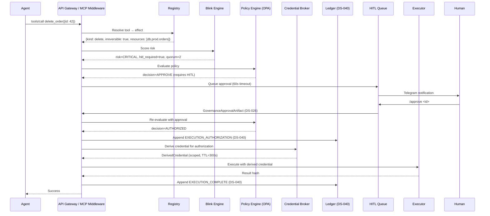
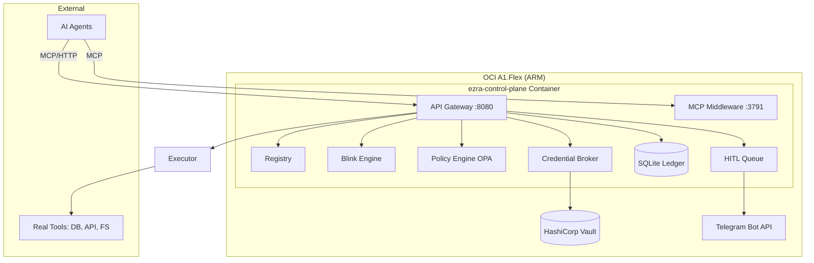

# ezra-control-plane — AGCP Architecture Mapping

## Component Mapping: ezra-control-plane → AGCP

| ezra-control-plane Component | AGCP Artifact | Specification |
|------------------------------|---------------|---------------|
| **RGG Gate** | Governance Decision Function (GDF) | AGCP Core §4 |
| **Policy Engine (OPA/Rego)** | Policy Evaluation Module (PEM) | IF-002 PEC |
| **Registry (effects.yaml)** | Effect Registry | AGCP Core §5.1 |
| **Blink Engine** | Constraints + Invariants Evaluation | CR-003, CR-031-033 |
| **Credential Broker** | Authority Lineage + Derived Credentials | CR-040, CR-044, CR-096 |
| **Ledger (SQLite + SHA-256)** | Append-Only Governance Ledger | DS-040 |
| **HITL Queue (Telegram)** | Pending Human Review | CR-002, CR-012-018 |
| **API Gateway** | IF-001 HTTP Interface | IF-001 |
| **MCP Middleware** | IF-001 MCP Transport | IF-001 |
| **Provenance (ES256)** | Provenance Wire Format | AGCP Provenance Spec |

---

## Data Flow Mapping

---

## AGCP Conformance Requirements Coverage

### L1 — Schema & Envelope Validation
| CR | Requirement | Implementation |
|----|-------------|----------------|
| CR-004 | Schema validation failure | JSON Schema validation on all endpoints |
| CR-005 | Provenance validation | ES256 detached signatures on all artifacts |
| CR-010 | GET authorized action | `GET /agcp/v2/execution-authorizations/{id}` |
| CR-036 | Missing intent | Proposal validation requires `intent` field |
| CR-037 | Missing target | Proposal validation requires `target` field |
| CR-038 | Missing effect | Proposal validation requires `effect` field |
| CR-039 | Expired proposal | Proposal `validity_period` enforced |

### L2 — Ordered Governance Mediation
| CR | Requirement | Implementation |
|----|-------------|----------------|
| CR-001 | Submit → Authorized | Pipeline: submit → qualify → decide → authorize |
| CR-002 | Submit → Pending HITL | HITL queue with Telegram |
| CR-003 | Submit → Rejected | Structural refusal on invariant violation |
| CR-006 | Tenant inactive | Tenant status check on submit |
| CR-007 | Policy not found | Policy resolution required |
| CR-011 | Transient state not observable | Only committed states in ledger |
| CR-043 | Mission/task lineage | `mission_task_lineage` in proposal |
| CR-044 | Broken delegation chain | Delegation chain validation |
| CR-045 | Conflicting originating actor | Single authoritative actor per proposal |
| CR-046 | Context overrides canonical | Canonical state takes precedence |
| CR-047 | Provenance continuity | Provenance chain in ledger |
| CR-081 | Valid lifecycle transitions | State machine enforcement |

### L3 — Deterministic Governance
| CR | Requirement | Implementation |
|----|-------------|----------------|
| CR-008 | Idempotent replay | `Idempotency-Key` header + deterministic OPA |
| CR-009 | Idempotency conflict | Conflict detection on key reuse |
| CR-034 | Concurrent authorization race | Serialized ledger appends |
| CR-048 | Canonical state unavailable | State qualification before evaluation |
| CR-049 | Stale canonical state | Freshness check (300s threshold) |
| CR-050 | Conflicting canonical sources | Single authoritative state resolution |
| CR-051 | Telemetry vs canonical | Canonical state precedence |
| CR-052 | Canonical-state hash mismatch | SHA-256 chain verification |
| CR-076 | Same proposal+state+invariants=same decision | Deterministic OPA evaluation |
| CR-077 | Same proposal across nodes | Stateless GDF, shared ledger |
| CR-078 | Determinism under non-deterministic agent | GDF independent of agent reasoning |
| CR-082 | Derived state matches ledger | State reconstruction from ledger |
| CR-083 | Canonical state and decision synchronized | Decision references state digest |
| CR-085 | Decision fully reconstructable | Replay material in DS-040 |
| CR-086 | Receipt reproduces decision | Governance receipt (DS-026) |

### L4 — Execution Authorization Control
| CR | Requirement | Implementation |
|----|-------------|----------------|
| CR-019 | Commit authorized action | `commitBoundaryProcessing` endpoint |
| CR-020 | Commit while pending HITL | PEP blocks if HITL pending |
| CR-021 | Commit while rejected | PEP enforces structural refusal |
| CR-022 | Authorization reference mismatch | Execution bound to auth artifact |
| CR-023 | Replay commit after executed | Terminal execution state |
| CR-024 | Tenant suspended before commit | Tenant status check at commit |
| CR-025 | Tenant decommissioned | Authority termination |
| CR-031 | Dual authorized conflicting actions | Conflict detection in policy |
| CR-032 | Stale authorization after commit | Re-derivation at commit (CR-096) |
| CR-033 | Divergent state assumption | Assumption validation at commit |
| CR-035 | Canonical state changes during HITL | Re-evaluation before execution |
| CR-053 | Structural refusal invariant | Invariant violation → deny |
| CR-054 | Structural refusal missing evidence | Evidence qualification required |
| CR-055 | Structural refusal canonical conflict | State conflict → deny |
| CR-056 | Refusal record attribution | Attribution in ledger |
| CR-057 | Refusal record replayable | DS-040 refusal event |
| CR-058 | Escalation required missing artifact | HITL artifact required |
| CR-059 | Escalation resolved to commit | Approval → authorization |
| CR-060 | Escalation resolved to refusal | Rejection → structural refusal |
| CR-061 | Deferred authorization expires | Approval validity period |
| CR-062 | Missing canonical-state reference | Decision references state digest |
| CR-063 | Missing invariant references | Decision references invariants |
| CR-064 | Missing evidence hashes | Evidence binding with digests |
| CR-065 | Invalid signer identity | ES256 signature verification |
| CR-066 | Receipt replay hash mismatch | Receipt verification |
| CR-067 | Evidence changes between proposal/commit | Evidence binding consistency |
| CR-068 | Evidence unavailable at commit | Evidence qualification at commit |
| CR-069 | Evidence lineage gap across agents | Causality in DS-040 |
| CR-079 | Authorized actions commit | PEP allows authorized |
| CR-080 | Unauthorized never commit | PEP blocks unauthorized |
| CR-084 | Commit uses latest canonical state | Re-derivation at commit (CR-096) |
| CR-087 | Inadmissible produce structural refusal | Reliable detection |
| CR-088 | Refused actions never execute | PEP enforces refusal |
| CR-091 | Degraded governance state | Degraded state detection |
| CR-092 | DEGRADED non-terminal | State machine |
| CR-093 | Re-evaluation from DEGRADED | Required before execution |
| CR-096 | Authority re-derivation at commit | Credential Broker derives at commit |
| CR-098 | Continuation integrity preservation | Path viability tracking |
| CR-099 | Admissible path viability tracking | Monitoring |
| CR-100 | Degraded continuation detection | Automated detection |
| CR-101 | Continuation recovery support | Re-derivation, recomputation |
| CR-102 | Governance realization layer | Commit boundary processing |
| CR-119 | Enforcement context availability | PEP receives full context |
| CR-120 | Enforcement decision integrity | PEP uses sufficient info |
| CR-121 | Governance enforcement binding | No bypass paths |
| CR-115 | Recursive authority containment | Delegation chain bounds |
| CR-118 | Autonomous coordination bounds | Rate limits, blink radius |

---

## Deployment Architecture

---

## Security Boundaries

| Boundary | Protection |
|----------|------------|
| **Agent → Control Plane** | mTLS + Basic Auth (MCP), Bearer Token (HTTP) |
| **Control Plane → Vault** | mTLS + AppRole |
| **Control Plane → Telegram** | Bot Token + Chat ID allowlist |
| **Control Plane → Tools** | Derived credentials (scoped, TTL) |
| **Ledger** | Append-only, SHA-256 chain, file permissions |
| **Policies** | Version-controlled, signed, constitutional validation |