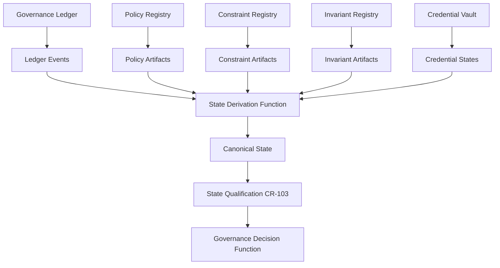

# ezra-control-plane — Canonical State Specification

## Overview

This document specifies the **Canonical State** derivation and management in ezra-control-plane, compliant with **AGCP v2.0.8 Canonical-State Governance (RG-4)**.

**Status**: Normative
**AGCP Version**: v2.0.8
**Conformance Level**: L4

---

## 1. Purpose

Canonical State is the **authoritative governance state** used for all authorization decisions. It must be:

- Deterministically resolved from qualified sources
- Sufficiently current (freshness)
- Single authoritative source (no conflicts)
- Verifiable and replayable

---

## 2. Canonical State Definition

```yaml
canonical_state:
  version: "2.0.8"
  state_id: "uuid"
  tenant_id: "uuid"
  governance_domain_id: "uuid"
  qualified_at: "ISO8601"
  qualified_by: "governance-decision-function"
  
  # Core state components
  proposals: {}           # Proposal states by ordering_scope
  authorizations: {}      # Authorization states
  approvals: {}           # HITL approval states
  policies: {}            # Active policy versions
  constraints: {}         # Active constraint versions
  invariants: {}          # Active invariant versions
  exceptions: {}          # Active exception versions
  credentials: {}         # Credential states
  ledger_position: {}     # Latest sequence per ordering_scope
  
  # Integrity
  state_digest: "sha256:..."
  previous_state_digest: "sha256:..."
  chain_digest: "sha256:..."
```

---

## 3. State Derivation (CR-048, CR-049, CR-050, CR-051, CR-052)



### Derivation Rules

| Source | Derivation Method | Authority |
|--------|-------------------|-----------|
| **Ledger Events** | Replay from genesis in sequence order | Authoritative for lifecycle |
| **Policy Registry** | Latest version per policy_id | Authoritative for policy |
| **Constraint Registry** | Latest version per constraint_id | Authoritative for constraints |
| **Invariant Registry** | Latest version per invariant_id | Authoritative for invariants |
| **Credential Vault** | Current derived credentials | Authoritative for execution |

### Conflict Resolution (CR-050)

```python
def resolve_conflicting_sources(sources: List[StateSource]) -> CanonicalState:
    """
    CR-050: Governance evaluation SHALL resolve a single authoritative state.
    """
    # Priority order (highest first):
    # 1. Ledger-derived state (append-only, immutable)
    # 2. Registry state (version-controlled, signed)
    # 3. Vault state (derived, ephemeral)
    
    ledger_state = derive_from_ledger(sources.ledger)
    registry_state = derive_from_registry(sources.registry)
    vault_state = derive_from_vault(sources.vault)
    
    # Merge with precedence
    merged = merge_states(
        ledger_state,      # Highest precedence
        registry_state,    # Medium precedence
        vault_state        # Lowest precedence
    )
    
    return merged
```

### Telemetry vs Canonical (CR-051)

```python
def evaluate_with_canonical_state(proposal: Proposal, telemetry: Telemetry) -> Decision:
    """
    CR-051: Canonical state SHALL take precedence over non-authoritative observations.
    """
    canonical = get_canonical_state()
    
    # Telemetry is INFORMATIONAL only
    # Never used for authorization decisions
    telemetry_context = {
        "observed_metrics": telemetry.metrics,
        "observed_state": telemetry.state,
        "note": "Non-authoritative - for monitoring only"
    }
    
    # Decision based ONLY on canonical state
    decision = gdf.evaluate(proposal, canonical)
    
    return Decision(
        outcome=decision,
        canonical_state_digest=canonical.state_digest,
        telemetry_context=telemetry_context
    )
```

---

## 4. State Qualification (CR-103, CR-104)

Before any admissibility evaluation, canonical state MUST be qualified:

```python
def qualify_canonical_state(state: CanonicalState) -> QualificationResult:
    """
    CR-103: Canonical state SHALL be qualified for:
    - Freshness
    - Provenance
    - Completeness
    - Consistency
    - Ordering integrity
    """
    checks = {
        "freshness": check_freshness(state),
        "provenance": check_provenance(state),
        "completeness": check_completeness(state),
        "consistency": check_consistency(state),
        "ordering_integrity": check_ordering_integrity(state)
    }
    
    all_passed = all(checks.values())
    
    if not all_passed:
        return QualificationResult(
            qualified=False,
            failed_checks=[k for k, v in checks.items() if not v],
            reason="Canonical state unsuitable for admissibility evaluation"
        )
    
    return QualificationResult(qualified=True, checks=checks)

def check_freshness(state: CanonicalState) -> bool:
    """CR-049: Stale canonical state check."""
    max_age_seconds = 300  # 5 minutes
    age = datetime.utcnow() - state.qualified_at
    return age.total_seconds() < max_age_seconds

def check_provenance(state: CanonicalState) -> bool:
    """Provenance chain continuity."""
    return verify_provenance_chain(state)

def check_completeness(state: CanonicalState) -> bool:
    """All required components present."""
    required = ["proposals", "authorizations", "policies", "constraints", "invariants"]
    return all(comp in state and state[comp] for comp in required)

def check_consistency(state: CanonicalState) -> bool:
    """Internal consistency (no contradictions)."""
    return verify_internal_consistency(state)

def check_ordering_integrity(state: CanonicalState) -> bool:
    """Ledger sequence integrity."""
    return verify_ledger_chain(state.ledger_position)
```

---

## 5. State Qualification Failure (CR-104)

```python
def governance_decision_state_suitability(state: CanonicalState) -> bool:
    """
    CR-104: Governance systems SHALL refuse admissibility evaluation
    when canonical-state suitability requirements cannot be established.
    """
    qualification = qualify_canonical_state(state)
    
    if not qualification.qualified:
        # REFUSE evaluation - do not proceed
        raise CanonicalStateUnsuitableError(
            f"Canonical state unsuitable: {qualification.failed_checks}"
        )
    
    return True
```

---

## 6. State Components Detail

### Proposals

```yaml
proposals:
  "proposal-uuid":
    proposal_id: "uuid"
    status: "SUBMITTED|QUALIFIED|AUTHORIZED|PENDING_HITL|REJECTED|COMMITTED|CONSUMED"
    intent: ""
    target: {}
    effect: ""
    risk_tier: ""
    blink_radius: {}
    submitted_at: "ISO8601"
    qualified_at: "ISO8601"
    authorized_at: "ISO8601"
    committed_at: "ISO8601"
    ledger_sequence: 5
```

### Authorizations

```yaml
authorizations:
  "auth-uuid":
    authorization_id: "uuid"
    proposal_id: "uuid"
    status: "ISSUED|CONSUMED|EXPIRED|REVOKED"
    decision: "AUTHORIZED"
    canonical_state_digest: "sha256:..."
    hitl_quorum_met: true
    issued_at: "ISO8601"
    expires_at: "ISO8601"
    consumed_at: "ISO8601|null"
```

### Policies/Constraints/Invariants

```yaml
policies:
  "policy-uuid":
    policy_id: "uuid"
    version: "1.2.3"
    content_hash: "sha256:..."
    registered_at: "ISO8601"
    active: true
    governance_domain_id: "uuid"

constraints:
  "constraint-uuid":
    constraint_id: "uuid"
    version: "1.0.0"
    content_hash: "sha256:..."
    registered_at: "ISO8601"
    active: true

invariants:
  "invariant-uuid":
    invariant_id: "uuid"
    version: "1.0.0"
    content_hash: "sha256:..."
    registered_at: "ISO8601"
    active: true
    type: "HARD|SOFT"
```

---

## 6. State Digest Computation

```python
def compute_state_digest(state: CanonicalState) -> str:
    """
    Deterministic state digest for verification.
    """
    # Canonicalize state (sorted keys, deterministic formatting)
    canonical = canonicalize_state(state)
    
    # SHA-256 digest
    digest = hashlib.sha256(canonical.encode()).hexdigest()
    
    return f"sha256:{digest}"

def canonicalize_state(state: CanonicalState) -> str:
    """Deterministic serialization for digest computation."""
    # Sort all keys, deterministic formatting
    return json.dumps(state.to_dict(), separators=(',', ':'), sort_keys=True)
```

---

## 7. State Reconstruction (CR-082, CR-085)

```python
def reconstruct_state_from_ledger(ledger_id: str, up_to_sequence: int = None) -> CanonicalState:
    """
    CR-082: Governance state SHALL be derivable from governance records.
    CR-085: Governance decisions SHALL be replayable.
    """
    events = ledger.retrieve(ledger_id, sequence_end=up_to_sequence)
    
    state = CanonicalState.initial()
    
    for event in events:
        state = apply_event(state, event)
    
    return state

def apply_event(state: CanonicalState, event: DS040Event) -> CanonicalState:
    """Apply single ledger event to state."""
    handlers = {
        "PROPOSAL_SUBMITTED": apply_proposal_submitted,
        "GOVERNANCE_DECISION": apply_governance_decision,
        "EXECUTION_AUTHORIZATION": apply_execution_authorization,
        "COMMIT_BOUNDARY": apply_commit_boundary,
        "GOVERNANCE_APPROVAL": apply_governance_approval,
        "STRUCTURAL_REFUSAL": apply_structural_refusal,
        "POLICY_REGISTERED": apply_policy_registered,
        "CONSTRAINT_REGISTERED": apply_constraint_registered,
        "INVARIANT_REGISTERED": apply_invariant_registered,
        "CREDENTIAL_DERIVED": apply_credential_derived,
    }
    
    handler = handlers.get(event.event_type)
    if handler:
        return handler(state, event)
    
    return state
```

---

## 8. Verification

```bash
# Qualify canonical state
python3 -m agcp.canonical-state qualify --tenant-id tenant-uuid --domain-id domain-uuid

# Reconstruct state from ledger
python3 -m agcp.canonical-state reconstruct --ledger-id tenant-domain --sequence 100

# Verify state digest
python3 -m agcp.canonical-state verify-digest --state-id uuid --expected sha256:...

# Check freshness
python3 -m agcp.canonical-state freshness --tenant-id tenant-uuid --max-age 300

# Test state qualification failure
python3 -m agcp.canonical-state test-unsuitable --corrupt-ledger
```