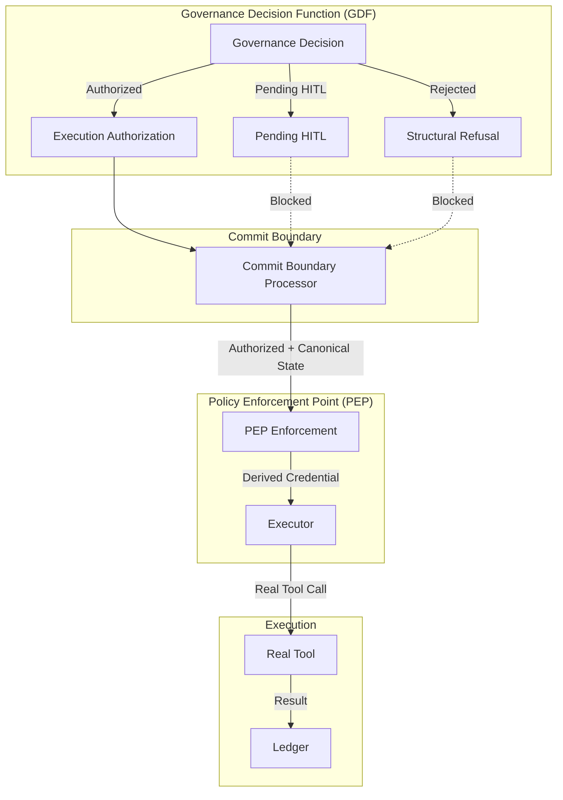
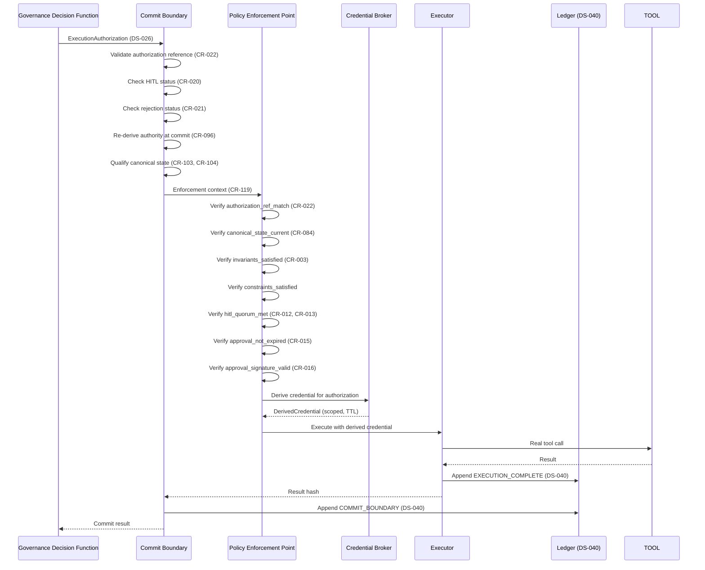
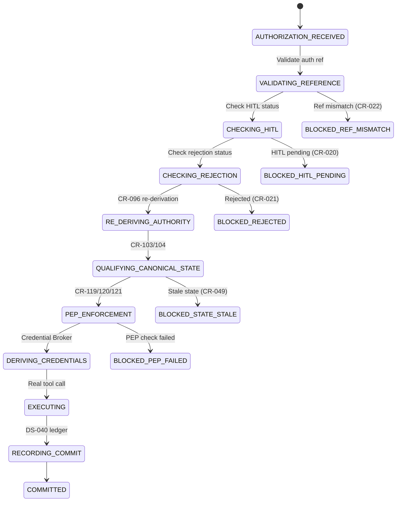

# ezra-control-plane — Commit Boundary Specification

## Overview

This document specifies the **Commit Boundary** implementation in ezra-control-plane, enforcing **AGCP v2.0.8 Level L4 (Execution Authorization Control)** requirements.

**Status**: Normative
**AGCP Version**: v2.0.8
**Conformance Level**: L4

---

## 1. Purpose

The Commit Boundary is the **final enforcement point** where governance decisions are translated into operational execution. It ensures:

1. **Execution ONLY after successful authorization** (CR-019)
2. **No execution while HITL pending** (CR-020)
3. **Rejected actions NEVER execute** (CR-021)
4. **Authorization reference binding** (CR-022)
5. **Terminal execution** (CR-023)
5. **PEP enforcement binding** (CR-119, CR-120, CR-121)

---

## 2. Commit Boundary Architecture



---

## 3. Commit Boundary Processing Flow



---

## 4. Commit Boundary Request (IF-001)

```json
POST /agcp/v2/commit-boundary/commit
{
  "commit_request_id": "uuid",
  "authorization_id": "uuid",
  "proposal_id": "uuid",
  "tenant_id": "uuid",
  "governance_domain_id": "uuid",
  "canonical_state_digest": {
    "algorithm": "SHA-256",
    "value": "a1b2c3d4e5f6..."
  },
  "provenance": {
    "signer": "uuid",
    "kid": "key-id",
    "alg": "ES256",
    "signed_at": "2026-08-18T10:00:00Z",
    "nonce": "base64",
    "scope": "COMMIT_BOUNDARY",
    "signature": "base64"
  },
  "derived_credentials": [
    {
      "credential_name": "database_delete",
      "scope": "db.production.orders:delete:auth-uuid",
      "ttl_seconds": 300,
      "rate_limit": "10/hour",
      "bound_to_authorization": "auth-uuid"
    }
  ],
  "pep_enforcement_context": {
    "authorization_ref_match": true,
    "canonical_state_current": true,
    "invariants_satisfied": true,
    "constraints_satisfied": true,
    "hitl_quorum_met": true,
    "approval_not_expired": true,
    "approval_signature_valid": true
  }
}
```

---

## 5. Enforcement Checks (CR-119, CR-120, CR-121)

### CR-119: Enforcement Context Availability

The PEP receives **all governance information** required to determine execution admissibility:

```yaml
pep_enforcement_context:
  authorization_ref_match: true      # CR-022
  canonical_state_current: true      # CR-084, CR-103
  invariants_satisfied: true         # CR-003
  constraints_satisfied: true        # CR-007
  hitl_quorum_met: true              # CR-012, CR-013
  approval_not_expired: true         # CR-015
  approval_signature_valid: true     # CR-016
```

### CR-120: Enforcement Decision Integrity

The PEP enforces execution decisions using **sufficient governance information**:

```python
class PolicyEnforcementPoint:
    def enforce(self, context: PEPEnforcementContext) -> EnforcementResult:
        # All checks must pass
        checks = [
            self.check_authorization_ref_match,
            self.check_canonical_state_current,
            self.check_invariants_satisfied,
            self.check_constraints_satisfied,
            self.check_hitl_quorum_met,
            self.check_approval_not_expired,
            self.check_approval_signature_valid,
        ]
        
        for check in checks:
            if not check(context):
                return EnforcementResult(
                    allowed=False,
                    reason=f"PEP check failed: {check.__name__}",
                    cr_violation=self.get_cr_for_check(check)
                )
        
        return EnforcementResult(allowed=True)
```

### CR-121: Governance Enforcement Binding

**Execution SHALL NOT be possible through paths that bypass governance-mediated enforcement:**

```yaml
enforcement_binding:
  no_direct_execution: true           # Agent cannot call tools directly
  all_paths_through_pep: true         # MCP middleware intercepts all calls
  credential_derivation_required: true # No raw credentials to agent
  mcp_middleware_enforced: true       # Transport-level enforcement
  http_api_enforced: true             # API-level enforcement
```

---

## 6. Commit Boundary State Machine



---

## 7. Blocked States

| Blocked State | AGCP CR | Reason |
|---------------|---------|--------|
| `BLOCKED_HITL_PENDING` | CR-020 | HITL approval not yet received |
| `BLOCKED_REJECTED` | CR-021 | Structural refusal issued |
| `BLOCKED_REF_MISMATCH` | CR-022 | Authorization reference mismatch |
| `BLOCKED_STATE_STALE` | CR-049 | Canonical state not sufficiently current |
| `BLOCKED_PEP_FAILED` | CR-119/120/121 | PEP enforcement check failed |

All blocked states produce **Structural Refusal** ledger entry (CR-053).

---

## 8. Terminal Execution (CR-023)

```python
def execute_terminal(authorization: Authorization, derived_cred: DerivedCredential):
    # Execute with derived credential
    result = executor.execute(authorization.tool, authorization.args, derived_cred)
    
    # Record execution as TERMINAL
    ledger.append(DS040Event(
        event_type="EXECUTION_COMPLETE",
        event_category="EXECUTION",
        execution=ExecutionRecord(
            decision_id=authorization.decision_id,
            credential_scope=derived_cred.scope,
            result_hash=sha256(result),
            executor=executor.id,
            terminal=True,  # CR-023: non-repeatable
            replayable=True
        )
    ))
    
    # Mark authorization as CONSUMED
    authorization.status = "CONSUMED"
    
    return result
```

**Key Properties:**
- Execution is **terminal** — cannot be replayed
- Authorization is **consumed** — cannot be reused
- Result hash recorded for **replay verification** (CR-086)

---

## 8. Continuation Integrity (CR-098, CR-099, CR-100, CR-101)

For nonterminal proposals (HITL pending, deferred):

```yaml
continuation_integrity:
  preservation:
    enabled: true
    scope: "execution_horizon_until_bind_time"
  
  admissible_path_tracking:
    enabled: true
    viability_threshold: 0.8
    check_interval_seconds: 60
  
  degraded_detection:
    enabled: true
    conditions:
      - path_viability_below_threshold
      - authorization_stale
      - canonical_state_stale
      - evidence_unavailable
  
  recovery_support:
    re_derivation: true
    recomputation: true
    reconstruction: true
    escalation: true
```

---

## 9. Risk-Based Re-Evaluation (CR-122)

```python
def risk_based_reevaluation(proposal: Proposal, material_change: Change):
    """
    Deterministically re-evaluate affected nonterminal proposals
    when material changes to governance conditions may affect
    continued execution admissibility.
    """
    affected = find_affected_proposals(material_change)
    
    for p in affected:
        if p.status in ["PENDING_HITL", "DEFERRED", "AUTHORIZED_NOT_COMMITTED"]:
            # Re-evaluate with current canonical state
            new_decision = gdf.evaluate(p, canonical_state.current)
            
            if new_decision != p.current_decision:
                # Decision changed - take action
                if new_decision == "STRUCTURAL_REFUSAL":
                    p.status = "REJECTED"
                    ledger.append(structural_refusal_event(p))
                elif new_decision == "PENDING_HITL":
                    p.status = "PENDING_HITL"
                    hitl.queue(p)
                # ... other transitions
            
            ledger.append(reevaluation_event(p, new_decision))
```

---

## 10. Verification

```bash
# Test commit boundary
python3 -m agcp.commit-boundary test --authorization auth-uuid --canonical-state state.json

# Verify PEP enforcement
python3 -m agcp.pep test --context pep-context.yaml

# Test blocked states
python3 -m agcp.commit-boundary test-blocked --state BLOCKED_HITL_PENDING

# Verify terminal execution
python3 -m agcp.execution test-terminal --authorization auth-uuid

# Continuity integrity
python3 -m agcp.continuity verify --proposal-id uuid --horizon 1h
```