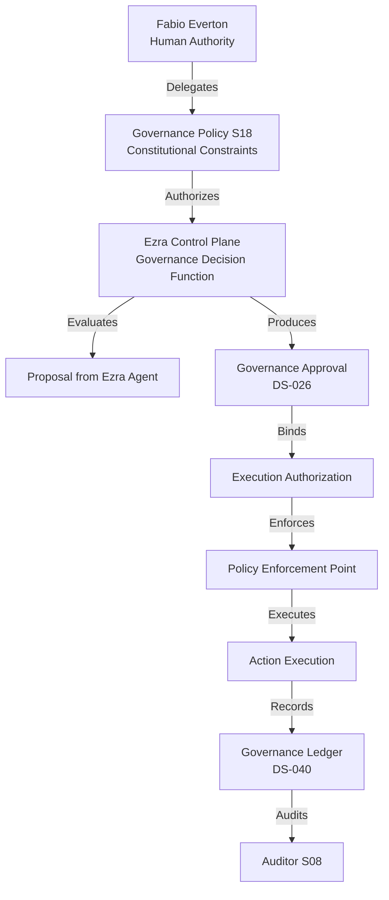

# AIGP Accountability Matrix

## AIGP Domain: Accountability

Maps to AGCP: Authority Lineage (CR-040, CR-044), Signer Identity (CR-065), Constitutional Validation (CR-111)

---

## RACI Matrix for AI Governance

| Activity | Fabio (Human Authority) | Ezra (AI Agent) | Governance Policy (S18) | Control Plane | Auditor (S08) |
|----------|------------------------|-----------------|------------------------|---------------|---------------|
| Define governance policy | **R** | I | **A** | C | I |
| Register policies/constraints | **A** | R | C | C | I |
| Submit proposals | I | **R** | I | C | I |
| Evaluate proposals | I | C | C | **R/A** | I |
| Human adjudication (HITL) | **R/A** | I | C | C | I |
| Execute authorized actions | I | **R** | I | **A** | I |
| Monitor execution | I | C | I | **R** | **A** |
| Audit decisions | I | I | I | C | **R/A** |
| Incident response | **A** | R | C | **R** | **R** |
| Update governance config | **A** | I | **R** | C | I |

**R** = Responsible, **A** = Accountable, **C** = Consulted, **I** = Informed

---

## Authority Lineage (CR-040, CR-044)



### Delegation Chain Verification

Each delegation step produces verifiable artifact:

1. **Fabio → Governance Policy**: Constitutional validation (CR-111)
2. **Policy → Control Plane**: Policy registration (IF-001 POST /governance-artifacts/policies)
3. **Control Plane → Proposal**: Proposal qualification (CR-036/037/038)
4. **Proposal → Decision**: Governance Decision Function (CR-076/077/078)
5. **Decision → Authorization**: Execution authorization (CR-019/020/021)
6. **Authorization → Execution**: PEP enforcement (CR-119/120/121)

---

## Signer Identity (CR-065)

Every governance artifact carries cryptographic attribution:

| Artifact | Signer | Algorithm | Verification |
|----------|--------|-----------|--------------|
| Policy registration | Fabio | ES256 | Public key in registry |
| Constraint registration | Fabio | ES256 | Public key in registry |
| Governance approval | Human reviewer | ES256 | Key ID + signature |
| Execution authorization | Control Plane | ES256 | Control Plane cert |
| Ledger event | Control Plane | SHA-256 chain | Predecessor binding |

---

## Constitutional Validation (CR-111, CR-112, CR-113, CR-114)

Before activation, all governance artifacts undergo:

```yaml
constitutional_validation:
  - check: "constraint_preservation"
    description: "Artifacts do not weaken constitutional constraints"
    agcp_cr: "CR-112"
  - check: "self_protection"
    description: "Artifacts cannot disable constitutional safeguards"
    agcp_cr: "CR-113"
  - check: "omission_analysis"
    description: "Material governance omissions detected"
    agcp_cr: "CR-114"
  - check: "self_modification_isolation"
    description: "System cannot modify own admissibility conditions"
    agcp_cr: "CR-117"
```

---

## Accountability Evidence

Each decision produces attributable evidence:

| Evidence Type | AGCP CR | Content |
|---------------|---------|---------|
| Proposal submission | CR-062 | Who proposed what, when, with what intent |
| Governance decision | CR-062, CR-063 | Which policy/constraint/invariant applied |
| Human adjudication | CR-016, CR-065 | Who approved, signature, validity |
| Execution authorization | CR-022, CR-065 | Bound to specific authorization |
| Execution result | CR-062, CR-067 | Evidence consistent across eval/exec |
| Audit trail | CR-085, CR-086 | Fully reconstructable from ledger |

---

## Verification

```bash
# Verify authority lineage
python3 -m agcp.lineage verify --proposal-id uuid --tenant-id tenant-uuid

# Check constitutional validation
python3 -m agcp.constitution validate --artifact-id uuid

# Audit accountability
python3 -m agcp.audit accountability --tenant-id tenant-uuid --date-range 2026-08-01:2026-08-31
```