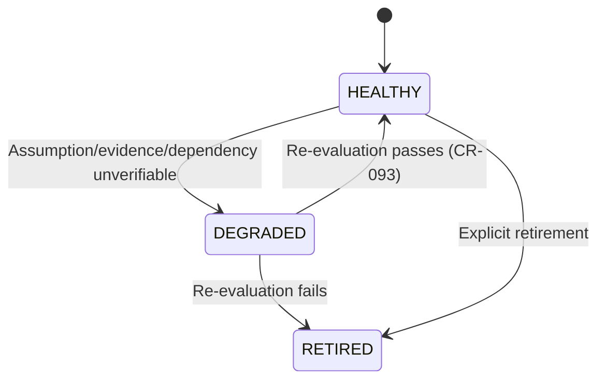

# AIGP Deployment Gate

## Gate: Deployment Monitoring
**Phase**: Monitor
**AGCP CRs**: CR-083, CR-084, CR-099, CR-119, CR-120, CR-121
**Trigger**: Model deployed to production

---

## Purpose

Establish continuous runtime monitoring with commit-bound admissibility, path viability tracking, and PEP enforcement.

---

## Monitoring Configuration

```yaml
deployment_monitoring:
  agcp_cr: "CR-083, CR-084, CR-099, CR-119, CR-120, CR-121"
  
  state_decision_sync:
    enabled: true
    interval_seconds: 60
    check: "governance_decisions_match_canonical_state"
    alert_on_mismatch: true
  
  commit_bound_admissibility:
    enabled: true
    check: "every_execution_re_evaluated_at_commit"
    canonical_state_freshness_seconds: 300
  
  path_viability:
    enabled: true
    interval_seconds: 300
    check: "admissible_paths_to_bind_viable"
    degraded_threshold: 0.8
  
  pep_enforcement:
    context_availability: true
    decision_integrity: true
    no_bypass_paths: true
    audit_interval_seconds: 3600
  
  blink_radius_monitoring:
    enabled: true
    rate_limit_enforcement: true
    anomaly_detection: true
```

---

## Degraded State Detection (CR-091, CR-092, CR-093)



### Degraded State Triggers

| Trigger | AGCP CR | Detection |
|---------|---------|-----------|
| Governance assumption invalid | CR-091 | Canonical state check |
| Evidence artifact unavailable | CR-091 | Evidence binding check |
| Contextual dependency broken | CR-091 | Dependency graph check |
| Authorization condition failed | CR-091 | Authorization re-derivation |
| Canonical state dependency failed | CR-091 | State qualification |

### Degraded State Response

```yaml
degraded_state_response:
  detection: "automatic"
  notification: "immediate"
  re_evaluation_required: true
  max_degraded_duration_hours: 24
  auto_recovery:
    - re_derive_authorization: true
    - recompute_canonical_state: true
    - reconstruct_evidence: true
    - escalate_to_hitl: true
  if_unrecoverable:
    - structural_refusal: true
    - retirement_initiated: true
```

---

## Continuation Integrity (CR-098, CR-099, CR-100, CR-101)

```yaml
continuation_integrity:
  preservation:
    enabled: true
    scope: "execution_horizon_until_bind_time"
  
  admissible_path_tracking:
    enabled: true
    viability_threshold: 0.8
    check_interval_seconds: 60
  
  degraded_detection:
    enabled: true
    conditions:
      - path_viability_below_threshold
      - authorization_stale
      - canonical_state_stale
      - evidence_unavailable
  
  recovery_support:
    re_derivation: true
    recomputation: true
    reconstruction: true
    escalation: true
```

---

## Runtime Metrics

```yaml
metrics:
  - name: "governance_decision_latency_ms"
    target: "< 100"
    alert: "> 500"
  
  - name: "hitl_approval_rate"
    target: "> 0.95"
    alert: "< 0.80"
  
  - name: "structural_refusal_rate"
    target: "< 0.05"
    alert: "> 0.10"
  
  - name: "pep_enforcement_latency_ms"
    target: "< 50"
    alert: "> 200"
  
  - name: "blink_radius_anomaly_count"
    target: "0"
    alert: "> 0"
  
  - name: "degraded_state_duration_seconds"
    target: "0"
    alert: "> 3600"
  
  - name: "canonical_state_freshness_seconds"
    target: "< 60"
    alert: "> 300"
```

---

## Verification

```bash
# Check deployment health
python3 -m agcp.monitor deployment --model-id uuid --check all

# Verify degraded state detection
python3 -m agcp.test degraded-state --model-id uuid --trigger assumption_invalid

# Check continuation integrity
python3 -m agcp.continuity verify --model-id uuid --horizon 1h
```