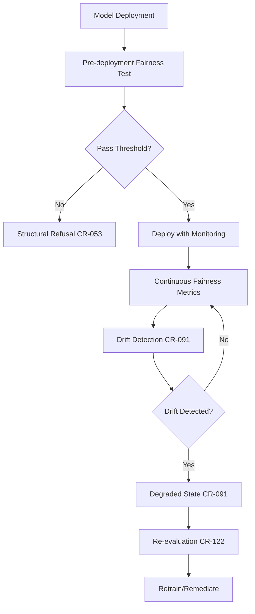
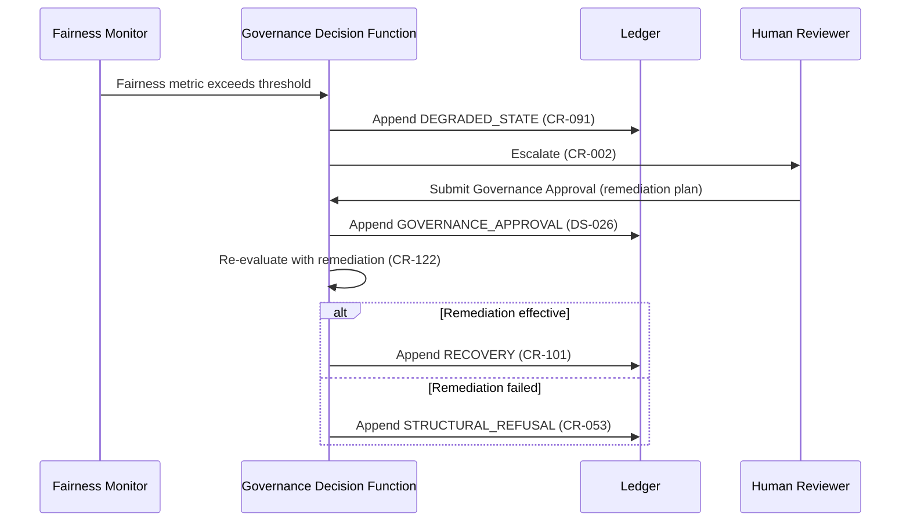

# AIGP Fairness Monitoring

## AIGP Domain: Fairness

Maps to AGCP: Evaluation/Testing (CR-079, CR-080, CR-087), State/Decision Sync (CR-083, CR-084), Reconstructable Decisions (CR-085, CR-086)

---

## Fairness Metrics Framework

| Metric Category | Metric | Threshold | AGCP CR | Runtime Check |
|-----------------|--------|-----------|---------|---------------|
| **Demographic Parity** | Selection rate difference | < 10% | CR-083, CR-084 | Commit-bound admissibility |
| **Equal Opportunity** | TPR difference | < 10% | CR-079, CR-080 | Authorized commit |
| **Equalized Odds** | TPR + FPR difference | < 10% | CR-087 | Structural refusal |
| **Calibration** | Prediction vs outcome | < 5% | CR-085, CR-086 | Decision reconstructable |
| **Individual Fairness** | Similar individuals → similar outcomes | 1.0 | CR-076, CR-077 | Deterministic governance |

---

## Fairness Monitoring Pipeline



---

## Pre-Deployment Fairness Gate

```yaml
fairness_gate:
  name: "pre_deployment_fairness"
  trigger: "model_deployment_proposal"
  agcp_cr: "CR-079, CR-080, CR-087"
  checks:
    - metric: "demographic_parity_difference"
      threshold: 0.10
      protected_attributes: ["gender", "race", "age"]
    - metric: "equal_opportunity_difference"
      threshold: 0.10
      protected_attributes: ["gender", "race", "age"]
    - metric: "calibration_error"
      threshold: 0.05
    - metric: "disparate_impact_ratio"
      threshold: 0.80
  outcome:
    pass: "AUTHORIZED"
    fail: "STRUCTURAL_REFUSAL"
  evidence:
    - test_dataset_hash: "sha256:..."
    - results_hash: "sha256:..."
    - ledger_event: "GOVERNANCE_DECISION"
```

---

## Continuous Fairness Monitoring

```yaml
continuous_monitoring:
  name: "runtime_fairness_monitoring"
  agcp_cr: "CR-083, CR-084, CR-099"
  schedule: "every_execution"
  metrics:
    - demographic_parity_difference
    - equal_opportunity_difference
    - calibration_error
    - prediction_distribution_shift
  alerting:
    warning_threshold: 0.08
    critical_threshold: 0.10
    action:
      warning: "log_and_notify"
      critical: "degraded_state_cr091"
  degraded_state_response:
    - re_evaluate_proposal: true
    - require_hitl: true
    - auto_remediate: false
```

---

## Fairness Evidence (CR-062, CR-064, CR-066, CR-067)

Each fairness check produces governance evidence:

```json
{
  "governance_evidence": {
    "evidence_id": "uuid",
    "evidence_type": "FAIRNESS_ASSESSMENT",
    "proposal_id": "uuid",
    "metrics": {
      "demographic_parity": {
        "gender": {"male": 0.52, "female": 0.48, "difference": 0.04},
        "race": {"white": 0.51, "black": 0.49, "difference": 0.02}
      },
      "equal_opportunity": {
        "gender": {"male": 0.75, "female": 0.73, "difference": 0.02}
      },
      "calibration": {
        "overall": 0.03,
        "by_group": {"male": 0.02, "female": 0.04}
      }
    },
    "thresholds": {
      "demographic_parity": 0.10,
      "equal_opportunity": 0.10,
      "calibration": 0.05
    },
    "passed": true,
    "test_dataset_digest": "sha256:...",
    "model_version": "v1.2.3",
    "timestamp": "2026-08-18T10:00:00Z"
  }
}
```

---

## Bias Incident Response (CR-053, CR-054, CR-058)



---

## Verification

```bash
# Run fairness assessment
python3 -m agcp.fairness assess --model-id uuid --dataset test.csv --protected gender,race,age

# Check continuous monitoring
python3 -m agcp.monitor fairness --model-id uuid --window 24h

# Verify fairness evidence in ledger
python3 -m agcp.ledger query --evidence-type FAIRNESS_ASSESSMENT --model-id uuid
```