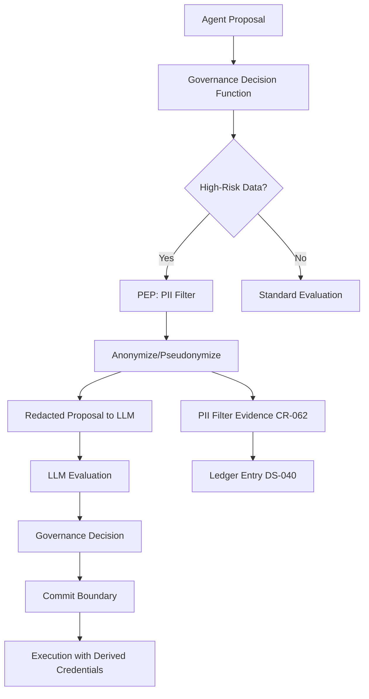

# AIGP Privacy by Design

## AIGP Domain: Privacy by Design

Maps to AGCP: Proposal Integrity (CR-036, CR-037, CR-038), PEP Enforcement (CR-119, CR-120, CR-121), Evidence Integrity (CR-062, CR-064)

---

## Privacy Principles → AGCP Mapping

| Privacy Principle | AGCP CR | Runtime Implementation |
|-------------------|---------|------------------------|
| **Data Minimization** | CR-036, CR-037, CR-038 | Proposal declares only necessary intent/target/effect |
| **Purpose Limitation** | CR-036, CR-037 | Intent binding prevents scope creep |
| **Anonymization/Pseudonymization** | CR-119, CR-120, CR-121 | PII filter at PEP before LLM context |
| **Storage Limitation** | CR-068, CR-069 | Retention records in DS-040 |
| **Integrity & Confidentiality** | CR-066, CR-067 | Integrity protection + evidence binding |
| **Accountability** | CR-040, CR-044, CR-065 | Authority lineage + signer identity |

---

## PII Filter at Commit Boundary



### PII Filter Rules

```yaml
pii_filter:
  enabled: true
  agcp_cr: "CR-119, CR-120, CR-121"
  patterns:
    - type: "email"
      regex: "[a-zA-Z0-9._%+-]+@[a-zA-Z0-9.-]+\\.[a-zA-Z]{2,}"
      action: "replace"
      replacement: "[EMAIL_REDACTED]"
    - type: "cpf"
      regex: "\\d{3}\\.?\\d{3}\\.?\\d{3}-?\\d{2}"
      action: "replace"
      replacement: "[CPF_REDACTED]"
    - type: "phone"
      regex: "(\\+55\\s?)?\\(?\\d{2}\\)?\\s?\\d{4,5}-?\\d{4}"
      action: "replace"
      replacement: "[PHONE_REDACTED]"
    - type: "credit_card"
      regex: "\\d{4}[-\\s]?\\d{4}[-\\s]?\\d{4}[-\\s]?\\d{4}"
      action: "replace"
      replacement: "[CARD_REDACTED]"
    - type: "address"
      regex: "rua|avenida|travessa|alameda|praça\\s+[^,]+,\\s*\\d+"
      action: "replace"
      replacement: "[ADDRESS_REDACTED]"
  custom_patterns: []
  llm_context_only: true
  evidence_logging: true
```

---

## Data Subject Rights Automation (LGPD Art. 18 + AIGP)

| Right | AGCP CR | Automation |
|-------|---------|------------|
| **Access** | CR-010, CR-062 | GET /governance-evidence/{id} |
| **Correction** | CR-062, CR-064 | Submit correction proposal |
| **Anonymization** | CR-053, CR-119 | Structural refusal + PII filter |
| **Portability** | CR-010, CR-085 | Export receipts + evidence |
| **Deletion** | CR-053, CR-054 | Structural refusal (retention policy) |
| **Information Sharing** | CR-062, CR-063 | Evidence binding references |
| **Consent Revocation** | CR-005, CR-015 | Invalidate approvals |
| **Opposition** | CR-053, CR-054 | Structural refusal |
| **Automated Decision Review** | CR-085, CR-086, CR-002 | Decision explanation + HITL |

---

## Cross-Border Transfer (LGPD Art. 33-36 + AIGP)

```yaml
cross_border_transfer:
  agcp_cr: "CR-026, CR-027, CR-028, CR-029, CR-030"
  mechanisms:
    - adequacy_decision: "EU/EEA countries"
    - standard_contractual_clauses: "SCC 2021/914"
    - binding_corporate_rules: "BCR approved"
    - specific_consent: "Art. 7 LGPD consent"
  enforcement:
    - tenant_isolation: true
    - governance_domain_isolation: true
    - ledger_isolation: true
    - evidence_isolation: true
```

---

## Privacy Impact Assessment (PIA) Gate

```yaml
pia_gate:
  name: "privacy_impact_assessment"
  trigger: "proposal_with_personal_data"
  agcp_cr: "CR-036, CR-037, CR-038, CR-119, CR-120, CR-121"
  required_for:
    - new_data_processing: true
    - high_risk_processing: true
    - cross_border_transfer: true
    - automated_decision_making: true
  assessment:
    - data_categories: []
    - legal_basis: ""
    - purpose: ""
    - retention_period: ""
    - recipients: []
    - transfers: []
    - security_measures: []
    - dpia_required: false
  outcome:
    pass: "AUTHORIZED"
    fail: "STRUCTURAL_REFUSAL"
  evidence:
    - pia_report_hash: "sha256:..."
    - ledger_event: "GOVERNANCE_DECISION"
```

---

## Verification

```bash
# Test PII filter
python3 -m agcp.pii test --input "Contact me at joao@email.com or 11999999999"

# Run PIA
python3 -m agcp.pia assess --proposal-id uuid --data-categories personal,sensitive

# Verify cross-border compliance
python3 -m agcp.transfer verify --destination-country US --mechanism scc
```