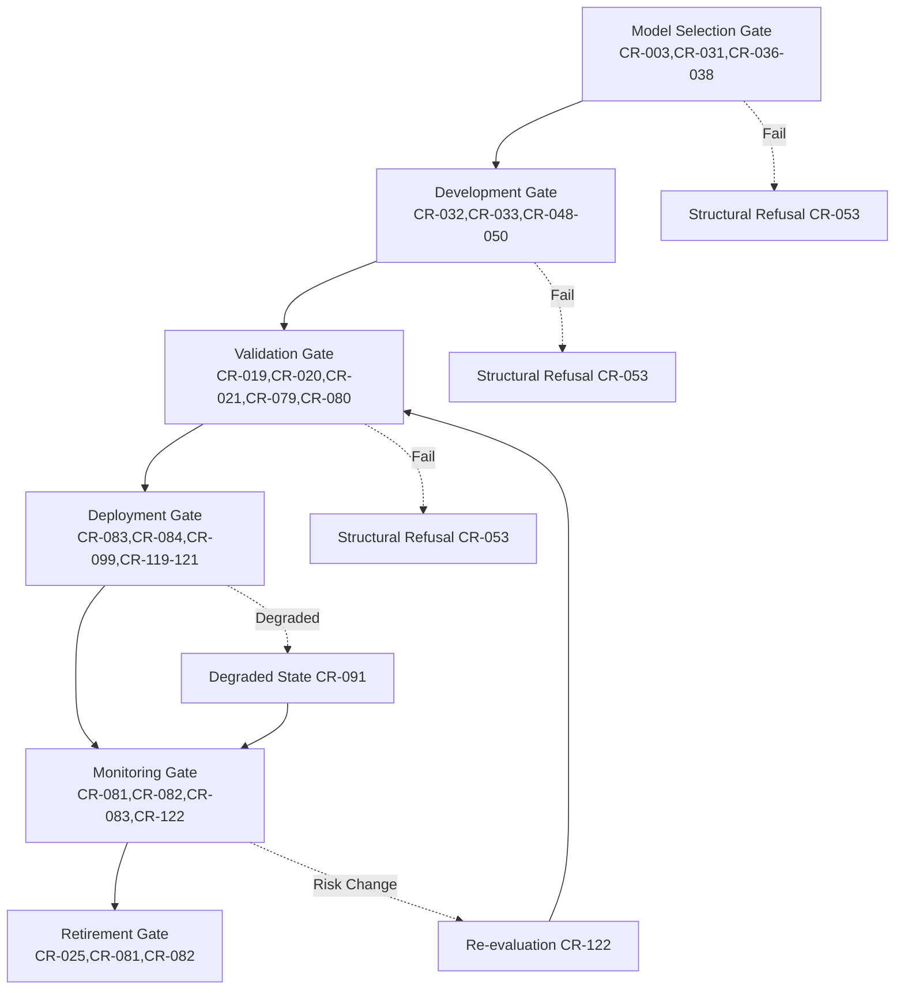

# AIGP Risk Management Lifecycle

## AIGP Domain: Risk Management

Maps to AGCP: Full lifecycle from CR-003 (invariants) through CR-122 (risk-based re-evaluation)

---

## Risk Management Phases → AGCP Gates

| AIGP Phase | AGCP Gate | CRs | Ezra Skill |
|------------|-----------|-----|------------|
| **1. Identify** | Model Selection Gate | CR-003, CR-031, CR-036, CR-037, CR-038 | governance-policy (S18) |
| **2. Assess** | Development Gate | CR-032, CR-033, CR-048, CR-049, CR-050 | design-de-loops (S14) |
| **3. Treat** | Validation Gate | CR-019, CR-020, CR-021, CR-079, CR-080 | ezra-control-plane |
| **4. Monitor** | Deployment Gate | CR-083, CR-084, CR-099, CR-119, CR-120, CR-121 | observability (S22) |
| **5. Review** | Monitoring Gate | CR-081, CR-082, CR-083, CR-122 | learning (S19) |
| **6. Retire** | Retirement Gate | CR-025, CR-081, CR-082 | governance-policy (S18) |

---

## Phase 1: Identify — Model Selection Gate

```yaml
gate_model_selection:
  name: "model_selection"
  trigger: "new_model_proposal"
  agcp_cr: "CR-003, CR-031, CR-036, CR-037, CR-038"
  required_artifacts:
    - model_card: true
    - risk_assessment: true
    - intended_use: true
    - legal_basis: true
  risk_tier_assignment:
    - criteria: "EU AI Act Annex III"
      tier: "high"
    - criteria: "GPAI >10^25 FLOPs"
      tier: "systemic"
    - criteria: "Art. 50 transparency"
      tier: "limited"
    - criteria: "Other"
      tier: "minimal"
  invariants_defined:
    - hard_invariants: []
    - soft_constraints: []
  outcome:
    pass: "PROCEED_TO_DEVELOPMENT"
    fail: "STRUCTURAL_REFUSAL"
```

---

## Phase 2: Assess — Development Gate

```yaml
gate_development:
  name: "development_assessment"
  trigger: "model_development_complete"
  agcp_cr: "CR-032, CR-033, CR-048, CR-049, CR-050"
  assessments:
    - fairness_testing: true
    - robustness_testing: true
    - security_testing: true
    - privacy_impact: true
    - canonical_state_establishment: true
  canonical_state:
    - model_version: ""
    - training_data_digest: "sha256:..."
    - hyperparameters: {}
    - evaluation_results: {}
  outcome:
    pass: "PROCEED_TO_VALIDATION"
    fail: "STRUCTURAL_REFUSAL"
```

---

## Phase 3: Treat — Validation Gate

```yaml
gate_validation:
  name: "validation_treatment"
  trigger: "model_ready_for_deployment"
  agcp_cr: "CR-019, CR-020, CR-021, CR-079, CR-080"
  validations:
    - authorized_commit: true
    - no_exec_pending_hitl: true
    - rejected_never_exec: true
    - hitl_gates_configured: true
    - pep_enforcement: true
  hitl_configuration:
    - risk_tier_high: "mandatory"
    - risk_tier_critical: "mandatory + quorum"
    - risk_tier_medium: "optional"
    - risk_tier_low: "none"
  outcome:
    pass: "PROCEED_TO_DEPLOYMENT"
    fail: "STRUCTURAL_REFUSAL"
```

---

## Phase 4: Monitor — Deployment Gate

```yaml
gate_deployment:
  name: "deployment_monitoring"
  trigger: "model_deployed"
  agcp_cr: "CR-083, CR-084, CR-099, CR-119, CR-120, CR-121"
  monitoring:
    - state_decision_sync: true
    - commit_bound_admissibility: true
    - path_viability: true
    - pep_context_availability: true
    - pep_decision_integrity: true
    - no_bypass_paths: true
  alerts:
    - degraded_state: "CR-091"
    - stale_authorization: "CR-032"
    - divergent_state: "CR-033"
    - invariant_violation: "CR-003"
  outcome:
    healthy: "CONTINUE_MONITORING"
    degraded: "RE_EVALUATION_CR122"
```

---

## Phase 5: Review — Monitoring Gate

```yaml
gate_monitoring_review:
  name: "periodic_review"
  trigger: "scheduled|risk_change|incident"
  agcp_cr: "CR-081, CR-082, CR-083, CR-122"
  review_scope:
    - lifecycle_integrity: true
    - ledger_reconstruction: true
    - state_sync: true
    - risk_based_reevaluation: true
  risk_changes:
    - new_threats: "CR-122"
    - model_drift: "CR-091"
    - regulatory_changes: "CR-122"
    - operational_changes: "CR-122"
  outcome:
    no_change: "CONTINUE"
    minor_change: "UPDATE_CONFIG"
    major_change: "RE_EVALUATION_CR122"
    critical_change: "DEGRADED_STATE_CR091"
```

---

## Phase 6: Retire — Retirement Gate

```yaml
gate_retirement:
  name: "model_retirement"
  trigger: "retirement_request|end_of_life|regulatory_ban"
  agcp_cr: "CR-025, CR-081, CR-082"
  retirement_process:
    - revoke_authorizations: true
    - archive_ledger: true
    - notify_downstream: true
    - data_disposal: true
    - final_audit: true
  tenant_decommissioned:
    - CR-025: "Governance authority terminates"
  outcome:
    complete: "RETIRED"
    partial: "PARTIAL_RETIREMENT"
```

---

## Complete Lifecycle Flow



---

## Risk Register Template

```yaml
risk_register:
  - risk_id: "RISK-001"
    phase: "development"
    description: "Model bias against protected group"
    likelihood: "high"
    impact: "high"
    agcp_cr: "CR-079, CR-080, CR-087"
    mitigation: "Fairness testing gate + continuous monitoring"
    residual_risk: "medium"
    owner: "ML Engineer"
    status: "mitigated"
  
  - risk_id: "RISK-002"
    phase: "deployment"
    description: "Adversarial attack on model"
    likelihood: "medium"
    impact: "critical"
    agcp_cr: "CR-119, CR-120, CR-121"
    mitigation: "PEP enforcement + input validation + rate limiting"
    residual_risk: "low"
    owner: "Security Engineer"
    status: "mitigated"
  
  - risk_id: "RISK-003"
    phase: "monitoring"
    description: "Model drift over time"
    likelihood: "high"
    impact: "high"
    agcp_cr: "CR-091, CR-099, CR-122"
    mitigation: "Drift detection + degraded state + re-evaluation"
    residual_risk: "medium"
    owner: "MLOps Engineer"
    status: "monitoring"
```

---

## Verification

```bash
# Run full lifecycle validation
python3 -m agcp.lifecycle validate --model-id uuid --phase all

# Check specific gate
python3 -m agcp.lifecycle gate --name model_selection --model-id uuid

# Risk register review
python3 -m agcp.risk register --model-id uuid --format yaml
```