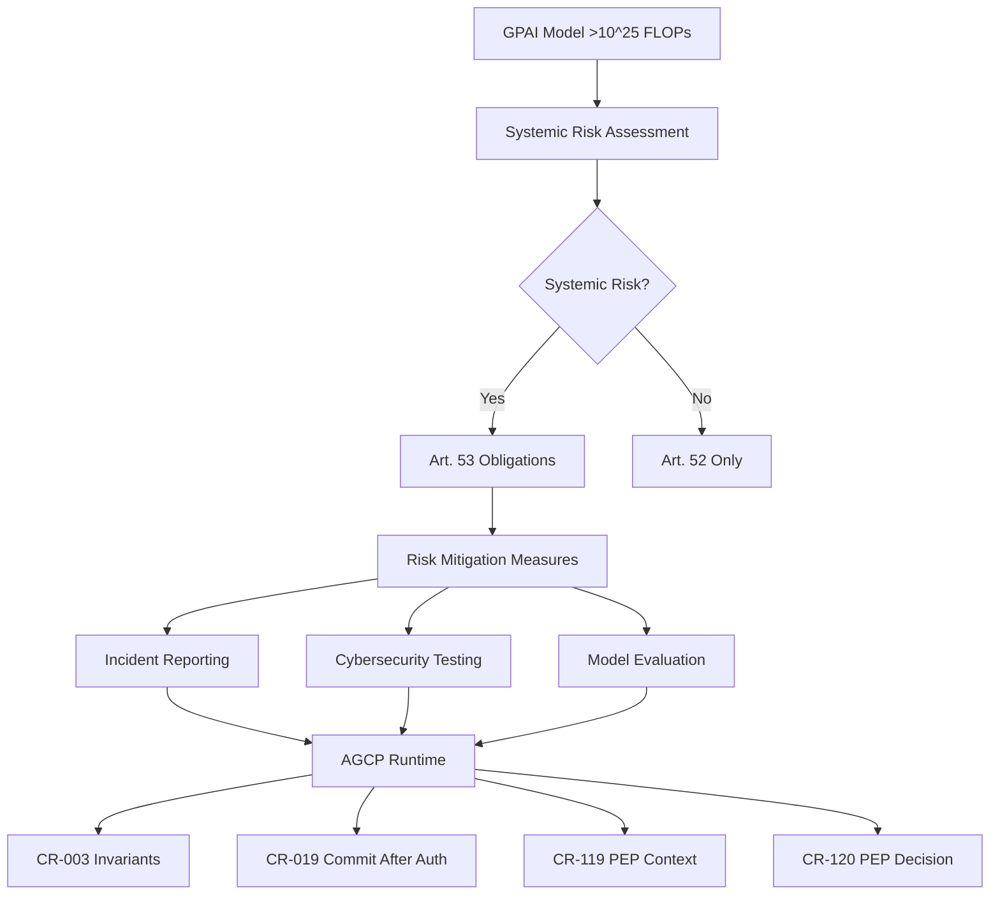
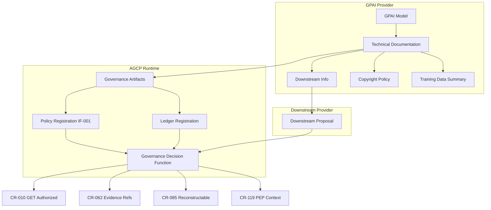

# EU AI Act Articles 51-56 — GPAI (General Purpose AI) Obligations

## Scope

Applies to **General Purpose AI Models** placed on the EU market or put into service in the EU.

| Model Type | Threshold | Articles |
|------------|-----------|----------|
| GPAI | Any | Art. 51-54 |
| GPAI with Systemic Risk | >10^25 FLOPs training compute | Art. 55-56 |

---

## Article 52 — Obligations of Providers of GPAI

| Obligation | AGCP CR | Runtime Implementation |
|------------|---------|------------------------|
| Technical documentation | CR-010, CR-062, CR-085 | Model cards + system cards in governance artifacts |
| Information for downstream providers | CR-010, CR-085, CR-086 | Decision reconstructable + receipt reproduces |
| Copyright policy | CR-036, CR-037, CR-038 | Proposal intent/target/effect includes copyright compliance |
| Training data summary | CR-062, CR-063 | Evidence binding with data provenance |

### Technical Documentation (Art. 52.1)

```yaml
gpai_technical_documentation:
  model_identification:
    name: ""
    version: ""
    provider: ""
    date: ""
  architecture:
    type: "transformer|diffusion|other"
    parameters: 0
    training_compute_flops: 0
  training_data:
    sources: []
    preprocessing: ""
    copyright_compliance: true
    data_summary: ""
  evaluation:
    benchmarks: []
    fairness_metrics: {}
    robustness_tests: []
  intended_use:
    permitted: []
    prohibited: []
  limitations:
    known_biases: []
    failure_modes: []
  governance:
    agcp_conformance: "L4"
    ledger_integration: true
    hitl_required: false
```

---

## Article 53 — Obligations of Providers of GPAI with Systemic Risk

| Obligation | AGCP CR | Runtime Implementation |
|------------|---------|------------------------|
| Systemic risk assessment | CR-003, CR-031, CR-032, CR-033 | Invariants + risk tiers + blink radius |
| Risk mitigation | CR-019, CR-020, CR-021 | Commit-bound + HITL + structural refusal |
| Incident reporting | CR-053, CR-054, CR-058 | Structural refusal + escalation |
| Cybersecurity | CR-119, CR-120, CR-121 | PEP enforcement + no bypass |
| Model evaluation | CR-079, CR-080, CR-087 | Authorized commit + unauthorized reject |

### Systemic Risk Assessment



---

## Article 54 — Authorized Representatives

Non-EU providers must appoint EU authorized representative.

| Requirement | AGCP CR | Implementation |
|-------------|---------|----------------|
| Written mandate | CR-040, CR-044 | Delegation references verifiable |
| Representative obligations | CR-044, CR-045 | Authority lineage preserved |
| Contact information | CR-010, CR-062 | GET authorized + evidence |

---

## Article 55 — Codes of Practice

| Requirement | AGCP CR | Implementation |
|-------------|---------|----------------|
| Participate in codes | CR-110, CR-111 | Constitutional validation |
| Compliance monitoring | CR-083, CR-084 | State/decision sync |

---

## Article 56 — Compliance by Design

| Requirement | AGCP CR | Implementation |
|-------------|---------|----------------|
| Compliance by design | CR-110, CR-111, CR-112 | Constitutional validation + constraint preservation |
| Lifecycle compliance | CR-081, CR-082, CR-083 | Lifecycle integrity + ledger reconstruction |

---

## GPAI Runtime Governance Integration



---

## Verification

```bash
# Verify GPAI documentation
python3 -m agcp.compliance eu-ai-act gpai --model-id model-uuid --provider provider-uuid

# Check systemic risk threshold
python3 -m agcp.risk assess --compute-flops 1e26 --model-type gpai

# Validate downstream information
python3 -m agcp.artifact verify --type downstream-info --artifact-id uuid
```