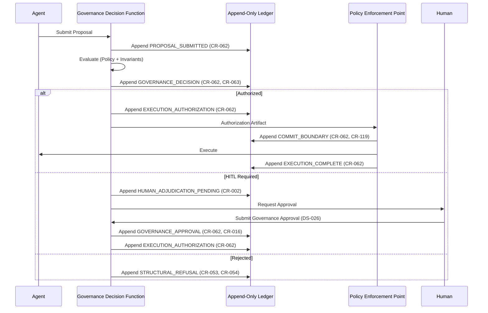

# EU AI Act Article 12 — Logging Requirements

## Requirement Text (Art. 12)

> High-risk AI systems shall technically allow for the automatic recording of events ('logs') over the duration of the lifetime of the system.

## AGCP Runtime Implementation

| Logging Requirement | AGCP CR | Implementation |
|---------------------|---------|----------------|
| Automatic event recording | CR-062, CR-063 | DS-040 Governance Ledger Events |
| Event identification | CR-062 | `ledger_event_id`, `event_type`, `event_category` |
| Timestamp | CR-062 | `event_time` (authoritative, not wall-clock) |
| Actor identification | CR-065 | `attribution` with signer identity |
| Integrity protection | CR-066, CR-067 | `integrity_protection` + predecessor binding |
| Evidence binding | CR-062, CR-064 | `evidence_binding.governance_evidence_refs` |
| Causality preservation | CR-069 | `causality` structure |
| Retention | CR-068 | `retention_record` in DS-040 |

## DS-040 Ledger Event Structure for Art. 12

```json
{
  "ledger_event_id": "uuid",
  "event_version": "2.0.8",
  "record_type": "GOVERNANCE_LEDGER_EVENT",
  "event_type": "PROPOSAL_SUBMITTED|GOVERNANCE_DECISION|EXECUTION_AUTHORIZATION|COMMIT_BOUNDARY|HUMAN_ADJUDICATION",
  "event_category": "LIFECYCLE|EXECUTION|EVIDENCE|ADMINISTRATIVE",
  "ledger_id": "tenant-governance-domain",
  "ordering_scope": "proposal-uuid",
  "ledger_position": {
    "sequence": 1,
    "predecessor_event_id": "uuid",
    "previous_event_digest": "sha256:...",
    "event_id": "uuid"
  },
  "tenant_id": "tenant-uuid",
  "governance_domain_id": "domain-uuid",
  "event_subject": {
    "subject_type": "PROPOSAL|AUTHORIZATION|EVIDENCE|POLICY",
    "subject_id": "uuid"
  },
  "event_artifact_refs": [
    {
      "artifact_uri": "agcp://tenant/domain/artifact/uuid",
      "artifact_digest": {
        "algorithm": "SHA-256",
        "value": "hex64"
      },
      "artifact_type": "PROPOSAL|POLICY|EVIDENCE|APPROVAL"
    }
  ],
  "governance_basis": {
    "policy_refs": ["agcp://tenant/domain/policy/uuid"],
    "constraint_refs": ["agcp://tenant/domain/constraint/uuid"],
    "invariant_refs": ["agcp://tenant/domain/invariant/uuid"]
  },
  "evidence_binding": {
    "governance_evidence_refs": ["agcp://tenant/domain/evidence/uuid"]
  },
  "causality": {
    "parent_event_id": "uuid",
    "dependency_event_ids": ["uuid"]
  },
  "event_time": "2026-08-18T10:00:00Z",
  "append_status": "APPENDED",
  "append_only_controls": {
    "immutable": true,
    "correction_by_subsequent_event": true
  },
  "integrity_protection": {
    "algorithm": "SHA-256",
    "digest": "sha256:...",
    "chain_digest": "sha256:..."
  },
  "attribution": {
    "actor_id": "actor-uuid",
    "actor_type": "HUMAN|AGENT|SYSTEM",
    "role": "PROPOSER|APPROVER|EXECUTOR|AUDITOR"
  },
  "provenance": {
    "signer": "actor-uuid",
    "kid": "key-id",
    "alg": "ES256",
    "signed_at": "2026-08-18T10:00:00Z",
    "nonce": "base64",
    "scope": "GOVERNANCE_LEDGER_EVENT",
    "signature": "base64"
  },
  "replay_material": {
    "ordered_event_content": {},
    "governance_basis": {},
    "artifact_reference_set": [],
    "evidence_reference_set": [],
    "causality": {},
    "ledger_chain_digests": []
  },
  "semantic_assertions": {
    "append_only": true,
    "authoritative_ordering": true,
    "tenant_isolation": true,
    "reference_resolvability": true,
    "provenance_chain_continuity": true,
    "non_authorizing_semantics": true,
    "correction_by_subsequent_event": true
  },
  "event_uri": "agcp://tenant/domain/ledger/uuid"
}
```

## Log Retention (Art. 12 + Art. 21)

| Log Type | Retention Period | AGCP Mechanism |
|----------|------------------|----------------|
| Governance ledger events | Lifetime of system + 10 years | `retention_record` in DS-040 |
| Proposal submissions | Lifetime of system | Immutable append-only |
| Governance decisions | Lifetime of system | Immutable append-only |
| Human adjudications | Lifetime of system | Immutable append-only |
| Execution authorizations | Lifetime of system | Immutable append-only |
| Commit boundary events | Lifetime of system | Immutable append-only |
| Evidence records | Lifetime of system | Immutable append-only |

## Runtime Enforcement



## Verification

```bash
# Verify ledger integrity
python3 -m agcp.ledger verify --ledger-id tenant-domain --sequence-start 0

# Verify Art. 12 compliance
python3 -m agcp.compliance eu-ai-act article-12 --ledger-id tenant-domain

# Export logs for audit
python3 -m agcp.ledger export --ledger-id tenant-domain --format jsonl --output audit-logs.jsonl
```