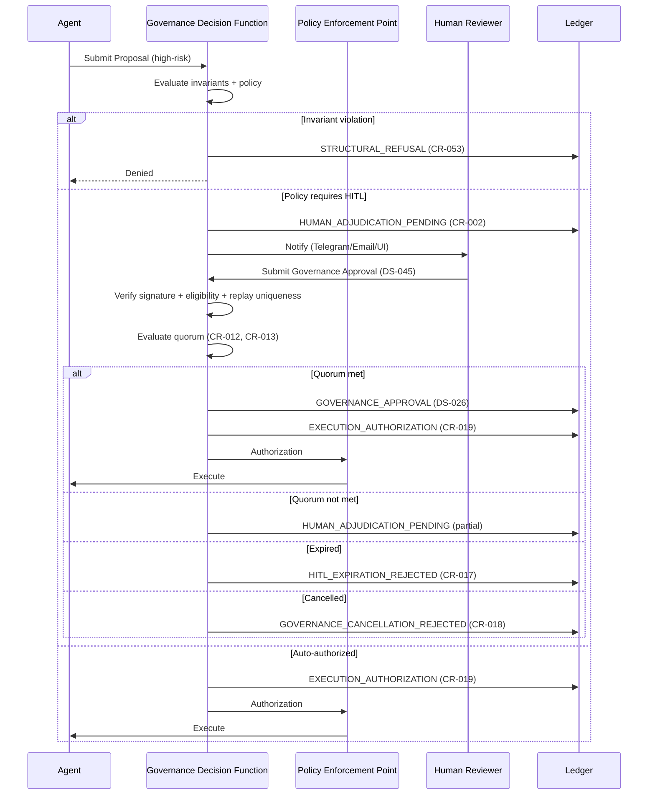

# EU AI Act Article 14 — Human Oversight Procedures

## Requirement Text (Art. 14)

> High-risk AI systems shall be designed and developed in such a way that they can be effectively overseen by natural persons during the period in which they are in use.

## AGCP Runtime Implementation

| Oversight Requirement | AGCP CR | Implementation |
|----------------------|---------|----------------|
| Human oversight measures | CR-002 | HITL escalation path in Governance Decision Function |
| Oversight before execution | CR-020 | No commit while pending HITL |
| Oversight authority | CR-012, CR-013 | Quorum-based cosignature |
| Oversight validity | CR-014, CR-015 | State-bound + expiry |
| Oversight attribution | CR-016 | Cryptographic signatures |
| Oversight termination | CR-017, CR-018 | Expiry → rejected, cancellation → rejected |

## HITL Escalation Flow



## Oversight Procedures by Risk Tier

### High-Risk Systems (Art. 14.1-14.4)

| Procedure | Trigger | Timeout | Escalation |
|-----------|---------|---------|------------|
| Pre-execution review | Proposal risk tier = HIGH | 60 seconds | Auto-reject if no response |
| Quorum approval | Multiple approvers required | 300 seconds | Partial quorum → wait |
| Emergency override | Critical system failure | 30 seconds | Single approver + audit |
| Periodic review | Scheduled (daily/weekly) | N/A | Audit trail review |

### Limited Risk (Art. 50)

| Procedure | Trigger | Implementation |
|-----------|---------|----------------|
| Bot disclosure | Every interaction | Auto-inject "I am an AI" |
| Content labeling | AI-generated output | Watermark/metadata |

## Governance Approval Artifact (DS-026)

```json
{
  "governance_approval_artifact_id": "uuid",
  "artifact_version": "2.0.8",
  "record_type": "GOVERNANCE_APPROVAL_ARTIFACT",
  "proposal_id": "uuid",
  "approval_type": "HUMAN_ADJUDICATION|RISK_ACCEPTANCE|CANCELLATION|WITHDRAWAL|QUORUM_PARTICIPATION",
  "approver_id": "human-uuid",
  "approver_role": "REVIEWER|AUTHORIZER|RISK_OWNER|EXECUTIVE",
  "tenant_id": "tenant-uuid",
  "governance_domain_id": "domain-uuid",
  "validity_period": {
    "valid_from": "2026-08-18T10:00:00Z",
    "valid_until": "2026-08-18T10:05:00Z"
  },
  "quorum_context": {
    "quorum_id": "uuid",
    "required_signatures": 2,
    "current_signatures": 1,
    "quorum_met": false
  },
  "provenance": {
    "signer": "human-uuid",
    "kid": "key-id",
    "alg": "ES256",
    "signed_at": "2026-08-18T10:00:00Z",
    "nonce": "base64",
    "scope": "GOVERNANCE_APPROVAL",
    "signature": "base64"
  },
  "approval_content": {
    "decision": "APPROVE|REJECT|CONDITIONAL",
    "conditions": [],
    "risk_acceptance": false,
    "rationale": "Human review rationale"
  },
  "lifecycle_effect": {
    "transitions_to": "AUTHORIZED|REJECTED|DEFERRED",
    "affects_proposal": "uuid"
  }
}
```

## Oversight Personnel Requirements

| Role | Responsibilities | AGCP CR |
|------|------------------|---------|
| **Reviewer** | Evaluate proposal, approve/reject | CR-014, CR-015 |
| **Authorizer** | Final authorization for high-risk | CR-013, CR-019 |
| **Risk Owner** | Accept residual risk | CR-031, CR-033 |
| **Executive** | Emergency override | CR-018, CR-113 |
| **Auditor** | Review decisions post-execution | CR-085, CR-086 |

## Training Requirements

```yaml
oversight_training:
  - module: "AGCP Governance Model"
    duration: "2 hours"
    covers: ["Lifecycle", "HITL", "Ledger", "Evidence"]
  - module: "Risk Assessment"
    duration: "3 hours"
    covers: ["Risk tiers", "Invariants", "Blink radius"]
  - module: "Tool Operation"
    duration: "1 hour"
    covers: ["Telegram bot", "Dashboard", "CLI"]
  - module: "Incident Response"
    duration: "2 hours"
    covers: ["Structural refusal", "Escalation", "Recovery"]
  - module: "Compliance"
    duration: "1 hour"
    covers: ["EU AI Act Art. 14", "NIST GOVERN", "LGPD Art. 48"]
```

## Verification

```bash
# Test HITL flow
python3 -m agcp.test hitl --proposal high-risk --approvers 2 --timeout 60

# Verify oversight procedures
python3 -m agcp.compliance eu-ai-act article-14 --tenant-id tenant-uuid

# Audit oversight decisions
python3 -m agcp.ledger query --event-type HUMAN_ADJUDICATION --tenant-id tenant-uuid
```