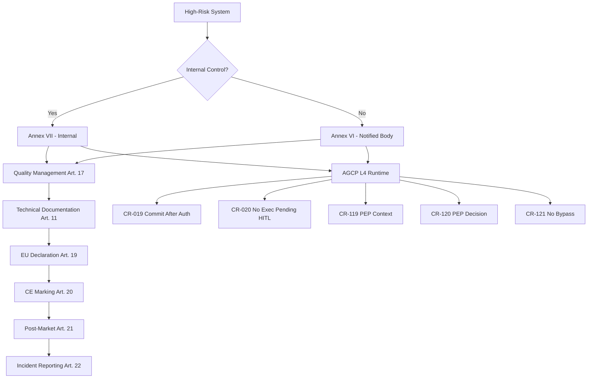

# EU AI Act Risk Classification — 4 Tiers

| Tier | Articles | Description | AGCP CRs | Ezra Enforcement |
|------|----------|-------------|----------|------------------|
| **Unacceptable** | Art. 5 | Prohibited: social scoring, subliminal manipulation, biometric ID, emotion recognition workplace/education | CR-003 (Hard invariant failure) | Structural refusal at proposal qualification |
| **High** | Art. 6-51, Annex III | Employment, credit, law enforcement, education, critical infrastructure, migration, justice | CR-019, CR-020, CR-021, CR-062, CR-064, CR-119, CR-120, CR-121 | Full L4: commit-bound + HITL + logging + PEP |
| **Limited** | Art. 50 | Chatbots, deepfakes, emotion recognition, biometric categorization | CR-010, CR-085, CR-086 | Transparency: bot disclosure + content labeling |
| **Minimal** | — | Spam filters, games, recommender systems | CR-004, CR-010 | Schema validation + basic transparency |

## High-Risk Requirements → AGCP Mapping

| EU AI Act Requirement | Article | AGCP CR | Runtime Implementation |
|----------------------|---------|---------|------------------------|
| Risk management system | Art. 9 | CR-003, CR-031, CR-032, CR-033 | Invariants + dual auth + divergent state |
| Data governance | Art. 10 | CR-036, CR-037, CR-038, CR-062, CR-064 | Proposal integrity + evidence hashes |
| Technical documentation | Art. 11 | CR-010, CR-062, CR-063, CR-085 | GET authorized + evidence + reconstructable |
| Record keeping (logging) | Art. 12 | CR-062, CR-063, CR-064, CR-066, CR-067 | Ledger events + evidence binding + consistency |
| Transparency to users | Art. 13 | CR-010, CR-085, CR-086 | GET authorized + decision reconstructable |
| Human oversight | Art. 14 | CR-002, CR-012-018 | HITL escalation + quorum + expiry + signatures |
| Accuracy/robustness/cybersecurity | Art. 15 | CR-032, CR-033, CR-119, CR-120, CR-121 | Stale auth + divergent state + PEP enforcement |
| Post-market monitoring | Art. 21 | CR-083, CR-084, CR-099, CR-122 | State sync + commit-bound + path viability + risk re-eval |
| Incident reporting | Art. 22 | CR-053, CR-054, CR-058, CR-059, CR-060 | Structural refusal + escalation + commit/refusal |

## Conformity Assessment Flow

## GPAI (General Purpose AI) — Art. 51-56

| Requirement | Article | AGCP CR | Implementation |
|-------------|---------|---------|----------------|
| Technical documentation | Art. 53 | CR-010, CR-062, CR-085 | Model cards + system cards |
| Downstream transparency | Art. 53 | CR-010, CR-085, CR-086 | Decision reconstructable |
| Copyright compliance | Art. 53 | CR-036, CR-037, CR-038 | Proposal intent/target/effect |
| Systemic risk assessment | Art. 55 | CR-003, CR-031, CR-032, CR-033 | Invariants + risk tiers |
| Incident reporting | Art. 55 | CR-053, CR-054, CR-058 | Structural refusal + escalation |