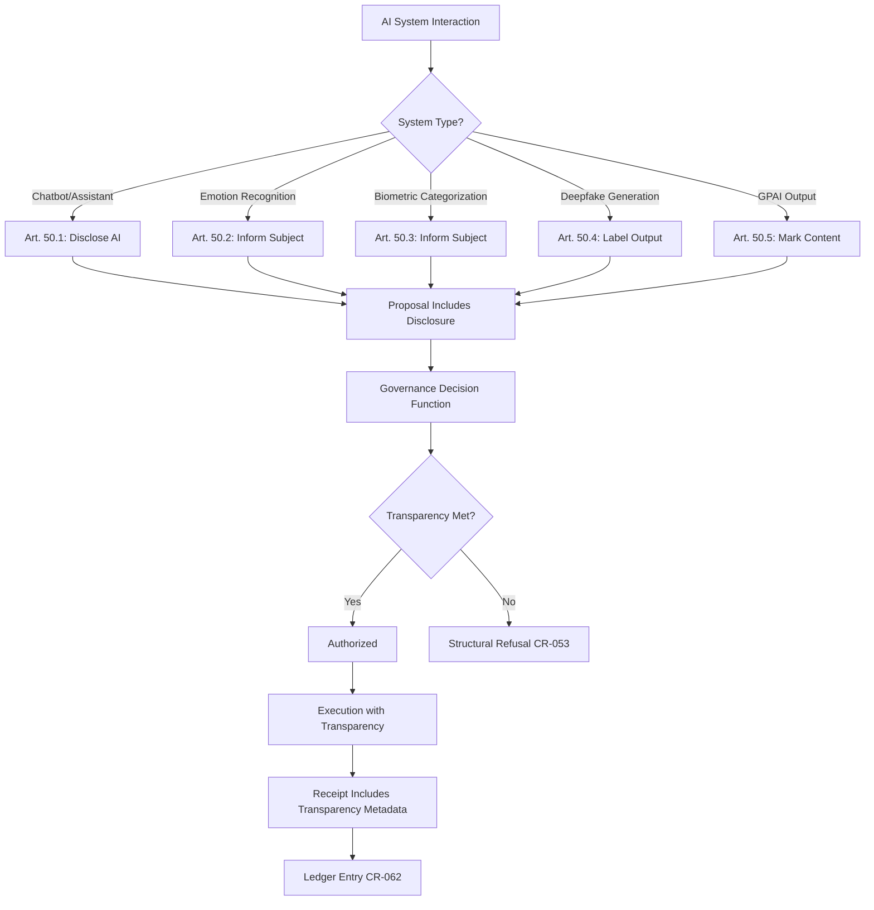

# EU AI Act Article 50 — Transparency Requirements

## Scope

Applies to **Limited Risk** AI systems and certain GPAI outputs.

| System Type | Article | Transparency Obligation |
|-------------|---------|------------------------|
| AI systems interacting with humans | Art. 50.1 | Disclose AI nature |
| Emotion recognition systems | Art. 50.2 | Inform subjects |
| Biometric categorization | Art. 50.3 | Inform subjects |
| Deepfake generation | Art. 50.4 | Disclose AI-generated |
| GPAI-generated content | Art. 50.5 | Mark/label output |

---

## AGCP Runtime Implementation

| Transparency Requirement | AGCP CR | Implementation |
|-------------------------|---------|----------------|
| AI disclosure to users | CR-010, CR-085 | GET authorized action returns AI identity |
| Emotion recognition notice | CR-010, CR-085 | Proposal includes subject notification |
| Biometric categorization notice | CR-010, CR-085 | Proposal includes subject notification |
| Deepfake labeling | CR-085, CR-086 | Decision reconstructable with content marking |
| GPAI output labeling | CR-010, CR-085, CR-086 | Receipt reproduces with labeling metadata |

---

## Runtime Enforcement



---

## Implementation by System Type

### 1. Chatbots / AI Assistants (Art. 50.1)

```yaml
transparency_art50_1:
  trigger: "human_interaction_start"
  action: "inject_disclosure"
  disclosure_text: "I am an AI assistant. This conversation is governed by AGCP runtime governance."
  metadata:
    ai_identity: true
    governance_framework: "AGCP v2.0.8 L4"
    ledger_recording: true
  agcp_cr: "CR-010, CR-085"
```

### 2. Emotion Recognition (Art. 50.2)

```yaml
transparency_art50_2:
  trigger: "emotion_analysis_request"
  action: "require_subject_consent"
  consent_required: true
  disclosure_text: "This system analyzes emotional states. Your consent is required."
  metadata:
    emotion_recognition: true
    subject_notified: true
    consent_recorded: true
  agcp_cr: "CR-010, CR-085, CR-005"
```

### 3. Biometric Categorization (Art. 50.3)

```yaml
transparency_art50_3:
  trigger: "biometric_categorization_request"
  action: "require_subject_notification"
  notification_required: true
  disclosure_text: "This system categorizes biometric data. You are being categorized."
  metadata:
    biometric_categorization: true
    subject_notified: true
    categories: []
  agcp_cr: "CR-010, CR-085"
```

### 4. Deepfake Generation (Art. 50.4)

```yaml
transparency_art50_4:
  trigger: "synthetic_media_generation"
  action: "watermark_and_label"
  watermark: true
  label: "AI-GENERATED"
  metadata:
    synthetic_media: true
    watermark_algorithm: "SHA-256"
    label_format: "C2PA"
    provenance: true
  agcp_cr: "CR-085, CR-086, CR-062"
```

### 5. GPAI Output (Art. 50.5)

```yaml
transparency_art50_5:
  trigger: "gpai_content_generation"
  action: "mark_output"
  marking_method: "metadata_embedding"
  metadata:
    gpai_generated: true
    model_id: "model-uuid"
    provider: "provider-name"
    generation_timestamp: "ISO8601"
    governance_ledger: "ledger-event-id"
  agcp_cr: "CR-010, CR-085, CR-086"
```

---

## Receipt Transparency Metadata

Every governance receipt includes transparency fields:

```json
{
  "governance_receipt": {
    "receipt_id": "uuid",
    "transparency_metadata": {
      "ai_disclosed": true,
      "disclosure_type": "CHATBOT|EMOTION_RECOGNITION|BIOMETRIC_CATEGORIZATION|DEEPFAKE|GPAI_OUTPUT",
      "subject_notified": true,
      "consent_recorded": false,
      "content_labeled": true,
      "label_format": "C2PA|METADATA|WATERMARK",
      "watermark_verified": true
    },
    "governance_outcome": "AUTHORIZED",
    "ledger_event_ref": "agcp://tenant/domain/ledger/uuid"
  }
}
```

---

## Verification

```bash
# Test transparency compliance
python3 -m agcp.compliance eu-ai-act article-50 --system-type chatbot --tenant-id tenant-uuid

# Verify disclosure injection
python3 -m agcp.test transparency --trigger human_interaction_start --expect-disclosure

# Audit transparency receipts
python3 -m agcp.ledger query --event-type EXECUTION_AUTHORIZATION --filter transparency_metadata.ai_disclosed=true
```