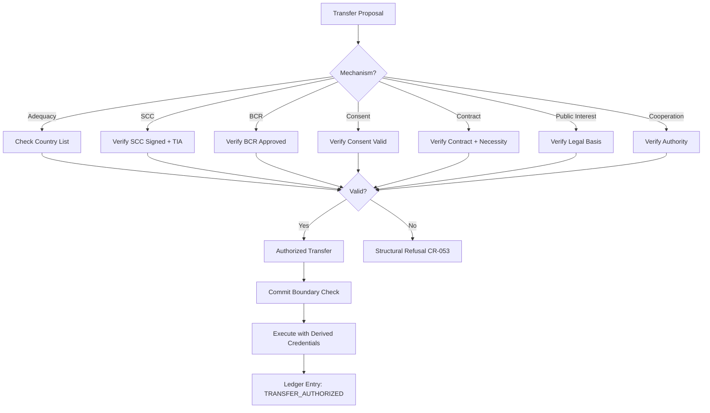

# LGPD Cross-Border Data Transfer (Art. 33-36)

## Legal Framework

| Article | Mechanism | Description | AGCP CR |
|---------|-----------|-------------|---------|
| **Art. 33** | International transfer rules | General principles | CR-026, CR-027, CR-028, CR-029, CR-030 |
| **Art. 34** | Adequacy decision | ANPD recognizes adequate protection | CR-026, CR-027 |
| **Art. 35** | Standard contractual clauses | ANPD-approved SCCs | CR-026, CR-027, CR-028 |
| **Art. 36** | Other mechanisms | BCRs, specific consent, etc. | CR-026, CR-027, CR-028, CR-029, CR-030 |

---

## Transfer Mechanisms

```yaml
transfer_mechanisms:
  - name: "adequacy_decision"
    article: "Art. 34"
    description: "ANPD recognizes country/organization with adequate protection"
    countries: ["EU/EEA", "UK", "Canada", "Japan", "New Zealand", "Switzerland", "Uruguay", "Argentina", "Israel", "Andorra", "Faroe Islands", "Guernsey", "Isle of Man", "Jersey"]
    agcp_cr: "CR-026, CR-027"
    requirements:
      - anpd_decision_published: true
      - no_additional_safeguards: true
    runtime_check: "destination_country in adequacy_list"
  
  - name: "standard_contractual_clauses"
    article: "Art. 35"
    description: "ANPD-approved SCCs (2021/914 EU model adapted)"
    agcp_cr: "CR-026, CR-027, CR-028"
    requirements:
      - scc_signed: true
      - supplementary_measures: "if_needed"
      - transfer_impact_assessment: true
    runtime_check: "scc_valid_and_signed"
  
  - name: "binding_corporate_rules"
    article: "Art. 36.I"
    description: "BCRs approved by ANPD"
    agcp_cr: "CR-026, CR-027, CR-028"
    requirements:
      - anpd_approved: true
      - legally_binding: true
      - enforceable_rights: true
    runtime_check: "bcr_approved_and_current"
  
  - name: "specific_consent"
    article: "Art. 36.II"
    description: "Explicit, specific, informed consent for transfer"
    agcp_cr: "CR-005, CR-026, CR-027"
    requirements:
      - explicit: true
      - specific: true
      - informed: true
      - revocable: true
    runtime_check: "consent_valid_and_current"
  
  - name: "contract_performance"
    article: "Art. 36.III"
    description: "Necessary for contract with data subject"
    agcp_cr: "CR-036, CR-037, CR-026"
    requirements:
      - contract_exists: true
      - necessary_for_performance: true
    runtime_check: "contract_valid_and_transfer_necessary"
  
  - name: "public_interest"
    article: "Art. 36.IV"
    description: "Public interest, legal claim, vital interests"
    agcp_cr: "CR-006, CR-007, CR-026"
    requirements:
      - legal_basis: true
      - necessary: true
    runtime_check: "legal_basis_verified"
  
  - name: "international_cooperation"
    article: "Art. 36.V"
    description: "International judicial/law enforcement cooperation"
    agcp_cr: "CR-006, CR-007, CR-026"
    requirements:
      - treaty_or_agreement: true
      - competent_authority: true
    runtime_check: "authority_verified"
```

---

## Transfer Impact Assessment (TIA)

```yaml
transfer_impact_assessment:
  required_for: ["scc", "bcr", "other_mechanisms"]
  agcp_cr: "CR-026, CR-027, CR-028, CR-029, CR-030"
  assessment:
    - destination_legal_framework:
        data_protection_law: ""
        government_access_laws: ""
        enforcement_mechanisms: ""
    - importer_practices:
        technical_measures: []
        organizational_measures: []
        sub_processors: []
    - supplementary_measures:
        technical: ["encryption", "pseudonymization", "split_processing"]
        contractual: ["audit_rights", "liability_clauses"]
        organizational: ["training", "certifications"]
    - risk_evaluation:
        likelihood: "high|medium|low"
        severity: "high|medium|low"
        overall: "high|medium|low"
  outcome:
    proceed: "risk_acceptable_with_measures"
    suspend: "risk_unacceptable"
  agcp_integration:
    - proposal_includes_tia: true
    - tia_evidence_in_ledger: true
    - transfer_gate_at_commit_boundary: true
```

---

## Runtime Transfer Gate



---

## AGCP Cross-Border Isolation (CR-026 to CR-030)

| CR | Requirement | Implementation |
|----|-------------|----------------|
| **CR-026** | Cross-tenant GET isolation | Transfer visibility respects tenant boundaries |
| **CR-027** | Cross-tenant cosign isolation | Transfer approvals don't cross tenants |
| **CR-028** | Cross-tenant commit isolation | Transfer execution authority tenant-scoped |
| **CR-029** | Cross-tenant policy resolution | Transfer policies tenant-isolated |
| **CR-030** | Cross-tenant ledger access | Transfer evidence tenant-isolated |

```yaml
cross_border_isolation:
  tenant_isolation: true
  governance_domain_isolation: true
  ledger_isolation: true
  evidence_isolation: true
  credential_isolation: true
  agcp_cr: "CR-026, CR-027, CR-028, CR-029, CR-030"
```

---

## Verification

```bash
# Check transfer mechanism
python3 -m agcp.lgpd transfer-check --destination US --mechanism scc --data-categories personal

# Run TIA
python3 -m agcp.lgpd tia --destination US --importer importer-uuid --data-categories personal,sensitive

# Verify isolation
python3 -m agcp.isolation verify --transfer-id uuid --tenant-id tenant-uuid
```