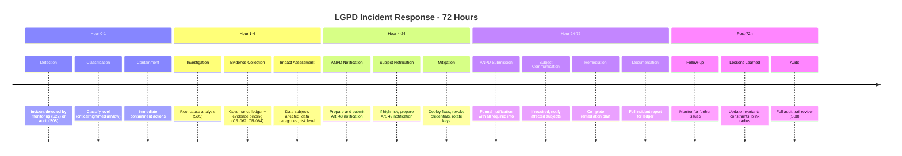

# LGPD Incident Response — 72 Hours (Art. 48-50)

## Legal Requirements

| Article | Requirement | Timeline | AGCP CR |
|---------|-------------|----------|---------|
| **Art. 48** | Communicate ANPD (National Data Protection Authority) | "Tempo razoável" (interpreted as 72h) | CR-053, CR-054, CR-058 |
| **Art. 49** | Communicate data subject if high risk | "Tempo razoável" | CR-010, CR-062, CR-063 |
| **Art. 50** | Adopt measures to reverse/mitigate effects | Immediate | CR-053, CR-054, CR-119, CR-120, CR-121 |

---

## Incident Classification

```yaml
incident_classification:
  - level: "critical"
    criteria:
      - sensitive_data_exposed: true
      - large_scale: "> 1000 subjects"
      - high_risk_rights: true
      - systemic_vulnerability: true
    response_time: "1 hour"
    anpd_notification: "within 72 hours"
    subject_notification: "within 24 hours"
    agcp_cr: "CR-053, CR-054, CR-058, CR-059"
  
  - level: "high"
    criteria:
      - personal_data_exposed: true
      - medium_scale: "100-1000 subjects"
      - moderate_risk: true
    response_time: "4 hours"
    anpd_notification: "within 72 hours"
    subject_notification: "within 48 hours"
    agcp_cr: "CR-053, CR-054, CR-058"
  
  - level: "medium"
    criteria:
      - limited_exposure: true
      - low_risk: true
    response_time: "24 hours"
    anpd_notification: "within 72 hours"
    subject_notification: "case_by_case"
    agcp_cr: "CR-053, CR-054"
  
  - level: "low"
    criteria:
      - no_personal_data: true
      - internal_only: true
    response_time: "72 hours"
    anpd_notification: "not_required"
    subject_notification: "not_required"
    agcp_cr: "CR-062, CR-063"
```

---

## 72-Hour Response Timeline



---

## ANPD Notification Template (Art. 48)

```yaml
anpd_notification:
  required_fields:
    - controller_identification:
        name: ""
        cnpj: ""
        dpo_contact: ""
    - incident_description:
        date_time: "ISO8601"
        duration: ""
        discovery_method: ""
    - data_categories_affected: []
    - data_subjects_affected:
        estimated_count: 0
        categories: []
    - risk_assessment:
        likelihood: "high|medium|low"
        severity: "high|medium|low"
        rights_impact: ""
    - measures_taken:
        containment: []
        mitigation: []
        prevention: []
    - dpo_contact: ""
  agcp_evidence:
    - ledger_events: ["uuid"]
    - governance_decisions: ["uuid"]
    - evidence_bindings: ["uuid"]
    - receipt_references: ["uuid"]
  submission:
    channel: "ANPD portal / email"
    deadline: "72 hours from awareness"
    confirmation: "protocol_number"
```

---

## Data Subject Notification Template (Art. 49)

```yaml
subject_notification:
  required_when: "high risk to rights and freedoms"
  required_fields:
    - incident_description: "clear and plain language"
    - data_categories: []
    - likely_consequences: ""
    - measures_taken: []
    - dpo_contact: ""
    - recommendations: ["change passwords", "monitor accounts", "enable 2FA"]
  delivery:
    channels: ["email", "push_notification", "postal"]
    language: "portuguese"
    timeline: "without undue delay"
```

---

## Incident Response Playbook

```yaml
playbook:
  phase_1_detection:
    triggers:
      - anomaly_detection_alert: "S22 observability"
      - audit_finding: "S08 auditor"
      - external_report: "security@ email"
      - data_subject_complaint: "lgpd rights request"
    actions:
      - auto_classify: true
      - alert_dpo: true
      - alert_security_team: true
      - start_evidence_collection: true
  
  phase_2_containment:
    actions:
      - revoke_compromised_credentials: "credential_broker"
      - isolate_affected_systems: "pep_enforcement"
      - rotate_keys: "provenance_keys"
      - block_suspicious_ips: "network_policy"
      - preserve_evidence: "ledger_snapshot"
  
  phase_3_investigation:
    actions:
      - root_cause_analysis: "S05 analise-causa-raiz"
      - timeline_reconstruction: "ledger_query"
      - impact_assessment: "data_subject_count + categories"
      - regulatory_assessment: "lgpd + eu_ai_act + nist"
  
  phase_4_notification:
    actions:
      - prepare_anpd_notification: "template_art48"
      - prepare_subject_notification: "template_art49"
      - legal_review: true
      - submit_anpd: "within_72h"
      - notify_subjects: "if_required"
  
  phase_5_remediation:
    actions:
      - deploy_fixes: "code_config_infrastructure"
      - update_invariants: "governance_policy"
      - update_blink_radius: "credential_broker"
      - update_hitl_gates: "governance_policy"
      - penetration_test: "validate_fixes"
  
  phase_6_documentation:
    actions:
      - incident_report: "full_timeline + root_cause + remediation"
      - ledger_entries: "all_governance_events"
      - lessons_learned: "update_framework"
      - compliance_evidence: "for_future_audits"
```

---

## AGCP Integration

```yaml
agcp_integration:
  ledger_events:
    - INCIDENT_DETECTED
    - CONTAINMENT_ACTION
    - INVESTIGATION_STARTED
    - ANPD_NOTIFICATION_SENT
    - SUBJECT_NOTIFICATION_SENT
    - REMEDIATION_DEPLOYED
    - INCIDENT_CLOSED
  
  evidence_binding:
    - incident_report_hash: "sha256:..."
    - root_cause_analysis_hash: "sha256:..."
    - remediation_plan_hash: "sha256:..."
    - anpd_protocol_number: ""
  
  governance_decisions:
    - containment_authorization: "CR-019"
    - credential_revocation: "CR-022"
    - key_rotation: "CR-096"
    - remediation_approval: "CR-002"
```

---

## Verification

```bash
# Simulate incident
python3 -m agcp.incident simulate --level critical --data-categories personal,sensitive

# Run 72h response drill
python3 -m agcp.incident drill --scenario data_breach --timer 72h

# Verify ANPD notification
python3 -m agcp.lgpd anpd-notify --incident-id uuid --dry-run

# Check incident ledger
python3 -m agcp.ledger query --event-type INCIDENT_DETECTED --tenant-id tenant-uuid
```