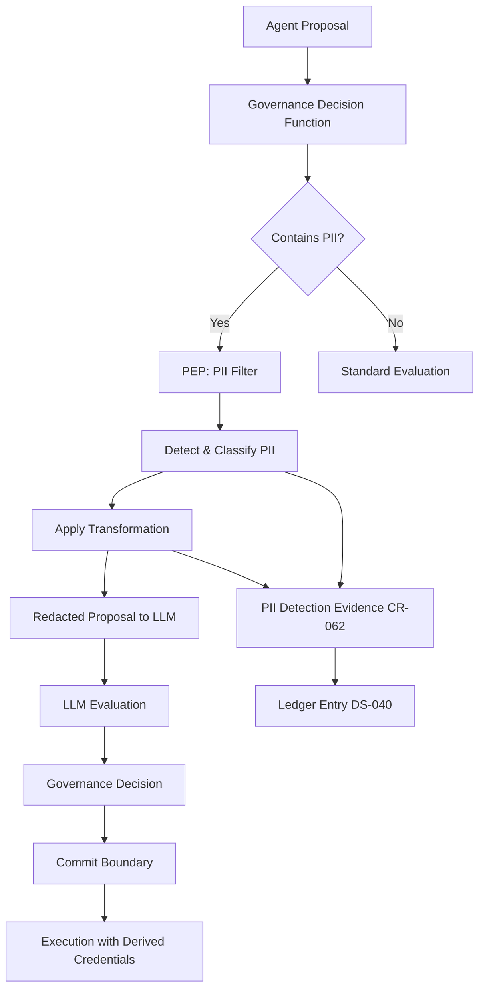

# LGPD PII Filter — Runtime at Commit Boundary

## Purpose

Prevent personal data from reaching LLMs and unauthorized systems. Enforced at **Policy Enforcement Point (PEP)** before commit boundary.

---

## AGCP Mapping

| LGPD Requirement | AGCP CR | Runtime Enforcement |
|------------------|---------|---------------------|
| Art. 6.VII (Security) | CR-119, CR-120, CR-121 | PEP enforcement + no bypass |
| Art. 46 (Security measures) | CR-119, CR-120, CR-121 | Technical measures at PEP |
| Art. 48 (Incident response) | CR-053, CR-054 | Structural refusal on PII leak |
| Art. 6.III (Necessity) | CR-036, CR-037, CR-119 | Data minimization at proposal |

---

## PII Filter Architecture



---

## PII Detection Rules

```yaml
pii_detection:
  enabled: true
  agcp_cr: "CR-119, CR-120, CR-121"
  engine: "regex + NER (spaCy/presidio)"
  confidence_threshold: 0.85
  
  patterns:
    # Brazilian identifiers
    - type: "cpf"
      name: "Cadastro de Pessoas Físicas"
      regex: "\\b\\d{3}\\.?\\d{3}\\.?\\d{3}-?\\d{2}\\b"
      action: "replace"
      replacement: "[CPF_REDACTED]"
      categories: ["identification", "sensitive"]
    
    - type: "cnpj"
      name: "Cadastro Nacional de Pessoa Jurídica"
      regex: "\\b\\d{2}\\.?\\d{3}\\.?\\d{3}/?\\d{4}-?\\d{2}\\b"
      action: "replace"
      replacement: "[CNPJ_REDACTED]"
      categories: ["identification"]
    
    - type: "rg"
      name: "Registro Geral"
      regex: "\\b\\d{1,2}\\.?\\d{3}\\.?\\d{3}-?[\\dXx]\\b"
      action: "replace"
      replacement: "[RG_REDACTED]"
      categories: ["identification"]
    
    - type: "cnh"
      name: "Carteira Nacional de Habilitação"
      regex: "\\b\\d{11}\\b"
      action: "replace"
      replacement: "[CNH_REDACTED]"
      categories: ["identification"]
    
    # Contact
    - type: "email"
      name: "Email address"
      regex: "\\b[a-zA-Z0-9._%+-]+@[a-zA-Z0-9.-]+\\.[a-zA-Z]{2,}\\b"
      action: "replace"
      replacement: "[EMAIL_REDACTED]"
      categories: ["contact"]
    
    - type: "phone_br"
      name: "Brazilian phone"
      regex: "\\b(\\+55\\s?)?\\(?\\d{2}\\)?\\s?\\d{4,5}-?\\d{4}\\b"
      action: "replace"
      replacement: "[PHONE_REDACTED]"
      categories: ["contact"]
    
    # Financial
    - type: "credit_card"
      name: "Credit card"
      regex: "\\b\\d{4}[-\\s]?\\d{4}[-\\s]?\\d{4}[-\\s]?\\d{4}\\b"
      action: "replace"
      replacement: "[CARD_REDACTED]"
      categories: ["financial", "sensitive"]
      luhn_check: true
    
    - type: "bank_account_br"
      name: "Brazilian bank account"
      regex: "\\b\\d{1,4}[-\\.]?\\d{1,4}[-\\.]?\\d{1,13}-?\\d\\b"
      action: "replace"
      replacement: "[BANK_ACCOUNT_REDACTED]"
      categories: ["financial"]
    
    - type: "pix_key"
      name: "PIX key"
      regex: "\\b([a-zA-Z0-9._%+-]+@[a-zA-Z0-9.-]+\\.[a-zA-Z]{2,}|\\d{11}|\\d{14}|\\+55\\d{10,11}|[a-f0-9]{8}-[a-f0-9]{4}-[a-f0-9]{4}-[a-f0-9]{4}-[a-f0-9]{12})\\b"
      action: "replace"
      replacement: "[PIX_KEY_REDACTED]"
      categories: ["financial"]
    
    # Address
    - type: "cep"
      name: "CEP (Brazilian postal code)"
      regex: "\\b\\d{5}-?\\d{3}\\b"
      action: "replace"
      replacement: "[CEP_REDACTED]"
      categories: ["address"]
    
    - type: "address_br"
      name: "Brazilian address"
      regex: "(rua|avenida|travessa|alameda|praça|rodovia|estrada)\\s+[^,]+,\\s*\\d+"
      action: "replace"
      replacement: "[ADDRESS_REDACTED]"
      categories: ["address"]
      flags: "i"
    
    # Health
    - type: "cns"
      name: "Cartão Nacional de Saúde"
      regex: "\\b\\d{15}\\b"
      action: "replace"
      replacement: "[CNS_REDACTED]"
      categories: ["health", "sensitive"]
    
    # Generic sensitive
    - type: "password"
      name: "Password/secret"
      regex: "(password|senha|secret|api_key|token)\\s*[:=]\\s*\\S+"
      action: "replace"
      replacement: "[SECRET_REDACTED]"
      categories: ["credential", "sensitive"]
      flags: "i"
    
    - type: "ip_address"
      name: "IP address"
      regex: "\\b(?:\\d{1,3}\\.){3}\\d{1,3}\\b"
      action: "replace"
      replacement: "[IP_REDACTED]"
      categories: ["technical"]
```

---

## NER-Based Detection (Complementary)

```yaml
ner_detection:
  enabled: true
  model: "pt_core_news_lg"  # Portuguese spaCy model
  entities:
    - PER: "Person names"
    - LOC: "Locations"
    - ORG: "Organizations"
    - DATE: "Dates (birthdates, etc.)"
    - TIME: "Times"
    - MONEY: "Monetary values"
    - PERCENT: "Percentages"
  action: "replace"
  replacement_map:
    PER: "[PERSON_REDACTED]"
    LOC: "[LOCATION_REDACTED]"
    ORG: "[ORGANIZATION_REDACTED]"
    DATE: "[DATE_REDACTED]"
    MONEY: "[MONEY_REDACTED]"
```

---

## Transformation Actions

```yaml
transformation_actions:
  replace:
    description: "Replace with token"
    example: "joao@email.com → [EMAIL_REDACTED]"
  
  mask:
    description: "Partial masking"
    example: "123.456.789-00 → ***.***.***-**"
  
  hash:
    description: "Deterministic hash for correlation"
    example: "joao@email.com → sha256:abc123..."
    use_case: "linking without exposing"
  
  remove:
    description: "Complete removal"
    example: "Full sentence removed"
  
  pseudonymize:
    description: "Consistent pseudonym"
    example: "João Silva → USER_7A3F"
    use_case: "maintain referential integrity"
```

---

## PII Filter at Commit Boundary

```yaml
commit_boundary_pii_check:
  enabled: true
  agcp_cr: "CR-119, CR-120, CR-121"
  timing: "pre_execution_authorization"
  
  checks:
    - proposal_content_scan: true
    - llm_context_scan: true
    - evidence_content_scan: true
    - receipt_content_scan: true
  
  on_detection:
    - auto_redact: true
    - log_detection: true
    - evidence_binding: true
    - if_unredactable: "structural_refusal"
  
  evidence:
    - detection_log_hash: "sha256:..."
    - redaction_applied: true
    - original_hash: "sha256:..."  # stored separately, encrypted
    - ledger_event: "PII_FILTER_APPLIED"
```

---

## Derived Credentials (No Raw Credentials to Agent)

```yaml
credential_isolation:
  principle: "Agent never sees raw credentials"
  agcp_cr: "CR-119, CR-120, CR-121"
  
  flow:
    1. Agent requests action requiring credential
    2. PEP evaluates authorization
    3. If authorized: Credential Broker derives scoped token
    4. Token has: specific resource, action, TTL, rate limit
    5. Agent receives token, executes
    6. Token expires, cannot be reused
  
  token_properties:
    - scope: "resource:action"
    - ttl_seconds: 300
    - rate_limit: "per blink_radius"
    - bound_to: "authorization_id"
    - non_replayable: true
  
  credential_broker:
    - vault_integration: "HashiCorp Vault / AWS Secrets Manager"
    - rotation: "automatic"
    - audit: "every_derivation_logged"
```

---

## Verification

```bash
# Test PII detection
python3 -m agcp.pii detect --text "Contact João at joao@email.com or 11999999999 CPF 123.456.789-00"

# Test commit boundary filter
python3 -m agcp.pii commit-check --proposal proposal.json

# Verify credential isolation
python3 -m agcp.credential test --action database_write --resource db.production.users

# Audit PII filter logs
python3 -m agcp.ledger query --event-type PII_FILTER_APPLIED --tenant-id tenant-uuid
```