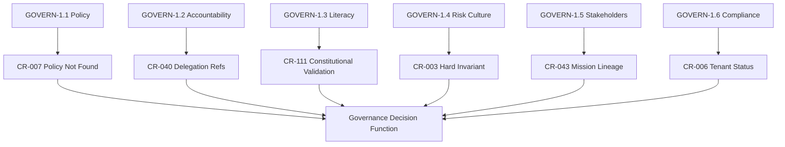

# NIST AI RMF GOVERN Function — 6 Subcategories

| Subcategory | Description | AGCP CRs | Ezra Skill | Runtime Enforcement |
|-------------|-------------|----------|------------|---------------------|
| GOVERN-1.1 | Governance policies, processes, procedures | CR-001, CR-007, CR-011 | governance-policy (S18) | Policy required before auth (CR-007) |
| GOVERN-1.2 | Accountability structures | CR-040, CR-044, CR-065 | governance-policy (S18) | Authority lineage + signer identity |
| GOVERN-1.3 | Workforce AI literacy | CR-110, CR-111 | governance-policy (S18) | Constitutional validation (CR-111) |
| GOVERN-1.4 | Risk management culture | CR-003, CR-031 | governance-policy (S18) | Hard invariant failure (CR-003) |
| GOVERN-1.5 | Stakeholder engagement | CR-043, CR-070 | governance-policy (S18) | Mission/task lineage (CR-043) |
| GOVERN-1.6 | Legal/regulatory compliance | CR-006, CR-007 | governance-policy (S18) | Tenant status + policy required |

## GOVERN Runtime Controls

## Evidence Requirements

Each GOVERN subcategory produces governance evidence:
- **Policy artifacts** (DS-006) registered via IF-001
- **Constraint artifacts** (DS-007) with invariant definitions (DS-008)
- **Authority lineage** (DS-024) for delegation chains
- **Constitutional validation** results (CR-111)