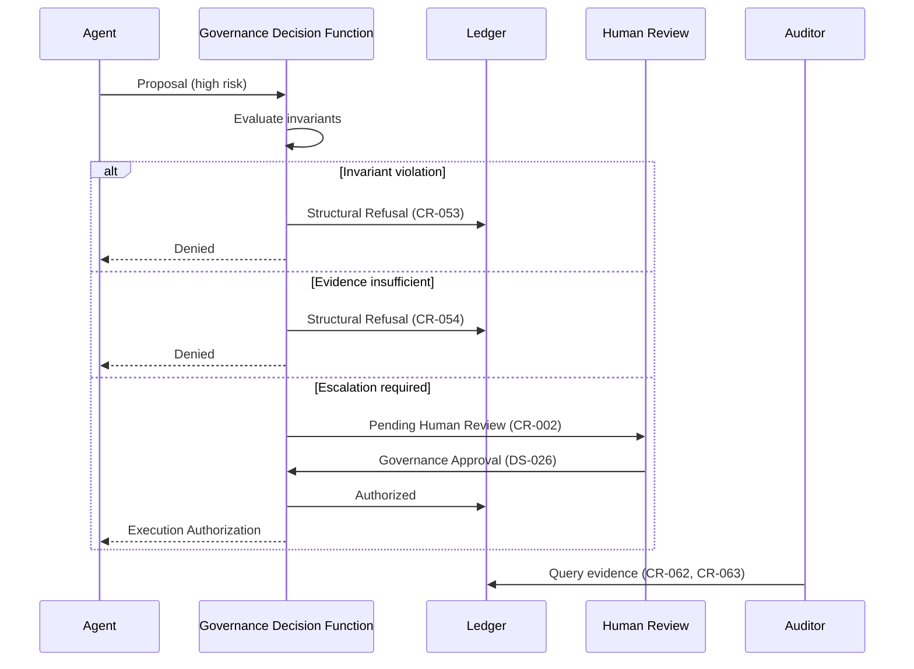

# NIST AI RMF MANAGE Function — 6 Subcategories

| Subcategory | Description | AGCP CRs | Ezra Skill | Runtime Enforcement |
|-------------|-------------|----------|------------|---------------------|
| MANAGE-1.1 | Risk response | CR-019, CR-020, CR-021 | ezra-control-plane | Commit after auth + no exec pending HITL + rejected never exec |
| MANAGE-1.2 | Resource allocation | CR-102, CR-119 | ezra-control-plane | Governance realization + PEP enforcement |
| MANAGE-1.3 | Incident response | CR-053, CR-054, CR-058 | auditor (S08) | Structural refusal + evidence insufficiency + escalation artifact |
| MANAGE-1.4 | Recovery planning | CR-100, CR-101 | learning (S19) | Degraded detection + continuation recovery |
| MANAGE-1.5 | Governance review | CR-081, CR-082, CR-083 | governance-policy (S18) | Lifecycle integrity + ledger reconstruction + state sync |
| MANAGE-1.6 | Communication/reporting | CR-010, CR-062, CR-063 | observability (S22) | GET authorized + evidence refs + invariant refs |

## MANAGE Runtime Controls

```mermaid
graph TD
    MG1[MANAGE-1.1 Response] --> CR019[CR-019 Commit After Auth]
    MG1 --> CR020[CR-020 No Exec Pending HITL]
    MG1 --> CR021[CR-021 Rejected Never Exec]
    MG2[MANAGE-1.2 Resources] --> CR102[CR-102 Realization Layer]
    MG2 --> CR119[CR-119 PEP Context]
    MG3[MANAGE-1.3 Incident] --> CR053[CR-053 Structural Refusal]
    MG3 --> CR054[CR-054 Missing Evidence]
    MG3 --> CR058[CR-058 Escalation Artifact]
    MG4[MANAGE-1.4 Recovery] --> CR100[CR-100 Degraded Detection]
    MG4 --> CR101[CR-101 Recovery Support]
    MG5[MANAGE-1.5 Review] --> CR081[CR-081 Lifecycle Integrity]
    MG5 --> CR082[CR-082 Ledger Reconstruction]
    MG5 --> CR083[CR-083 State Sync]
    MG6[MANAGE-1.6 Reporting] --> CR010[CR-010 GET Authorized]
    MG6 --> CR062[CR-062 State Reference]
    MG6 --> CR063[CR-063 Invariant Reference]
```

## Incident Response Flow (MANAGE-1.3)

