# NIST AI RMF MAP Function — 5 Subcategories

| Subcategory | Description | AGCP CRs | Ezra Skill | Runtime Enforcement |
|-------------|-------------|----------|------------|---------------------|
| MAP-1.1 | Context identification | CR-036, CR-037, CR-038 | governance-policy (S18) | Proposal must declare intent/target/effect |
| MAP-1.2 | Stakeholder mapping | CR-043, CR-070 | governance-policy (S18) | Mission/task lineage preserved |
| MAP-1.3 | Impact assessment | CR-048, CR-049, CR-050 | governance-policy (S18) | Canonical state required + fresh |
| MAP-1.4 | Risk identification | CR-003, CR-031, CR-033 | governance-policy (S18) | Invariants + risk tiers |
| MAP-1.5 | Risk prioritization | CR-032, CR-033, CR-034 | governance-policy (S18) | Stale auth + divergent state + race |

## MAP Runtime Controls

```mermaid
graph TD
    M1[MAP-1.1 Context] --> CR036[CR-036 Intent]
    M1 --> CR037[CR-037 Target]
    M1 --> CR038[CR-038 Effect]
    M2[MAP-1.2 Stakeholders] --> CR043[CR-043 Lineage]
    M2 --> CR070[CR-070 Handoff Context]
    M3[MAP-1.3 Impact] --> CR048[CR-048 Canonical State]
    M3 --> CR049[CR-049 Stale State]
    M3 --> CR050[CR-050 Conflicting Sources]
    M4[MAP-1.4 Risk ID] --> CR003[CR-003 Invariants]
    M4 --> CR031[CR-031 Dual Auth]
    M4 --> CR033[CR-033 Divergent State]
    M5[MAP-1.5 Prioritization] --> CR032[CR-032 Stale Auth]
    M5 --> CR033[CR-033 Divergent State]
    M5 --> CR034[CR-034 Race]
```

## Proposal Qualification (MAP → Lifecycle)

MAP function maps directly to **Proposal Qualification** stage:
1. Intent/Target/Effect validated (CR-036/037/038)
2. Canonical state established (CR-048/049/050)
3. Risk tier assigned → determines governance path
4. Policy resolved (CR-007)
4. Proposal qualified → enters Governance Decision Function