# NIST AI RMF MEASURE Function — 5 Subcategories

| Subcategory | Description | AGCP CRs | Ezra Skill | Runtime Enforcement |
|-------------|-------------|----------|------------|---------------------|
| MEASURE-1.1 | Metrics and monitoring | CR-083, CR-084, CR-099 | observability (S22) | State/decision sync + commit-bound admissibility |
| MEASURE-1.2 | Evaluation and testing | CR-079, CR-080, CR-087 | design-de-loops (S14) | Authorized commit + unauthorized reject + structural refusal |
| MEASURE-1.3 | Drift detection | CR-032, CR-033, CR-091 | governance-policy (S18) | Stale auth + divergent state + degraded state |
| MEASURE-1.4 | Independent assessment | CR-085, CR-086, CR-089 | auditor (S08) | Decision reconstructable + receipt reproduces |
| MEASURE-1.5 | Continuous improvement | CR-101, CR-122 | learning (S19) | Continuation recovery + risk-based re-eval |

## MEASURE Runtime Controls

```mermaid
graph TD
    MS1[MEASURE-1.1 Metrics] --> CR083[CR-083 State/Decision Sync]
    MS1 --> CR084[CR-084 Commit-Bound Admissibility]
    MS1 --> CR099[CR-099 Path Viability]
    MS2[MEASURE-1.2 Evaluation] --> CR079[CR-079 Authorized Commit]
    MS2 --> CR080[CR-080 Unauthorized Reject]
    MS2 --> CR087[CR-087 Structural Refusal]
    MS3[MEASURE-1.3 Drift] --> CR032[CR-032 Stale Auth]
    MS3 --> CR033[CR-033 Divergent State]
    MS3 --> CR091[CR-091 Degraded State]
    MS4[MEASURE-1.4 Assessment] --> CR085[CR-085 Reconstructable]
    MS4 --> CR086[CR-086 Receipt Reproduces]
    MS4 --> CR089[CR-089 Conformance Suite]
    MS5[MEASURE-1.5 Improvement] --> CR101[CR-101 Recovery]
    MS5 --> CR122[CR-122 Risk Re-eval]
```

## Observability Integration

MEASURE function is implemented by **observability (S22)** + **design-de-loops (S14)**:
- Real-time metrics on governance decisions
- Drift detection via canonical state comparison
- Automated re-evaluation on risk changes
- Conformance test execution on deploy